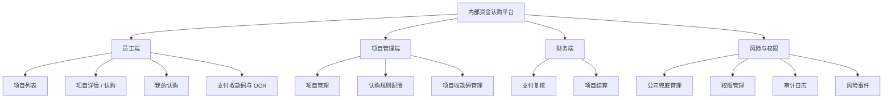
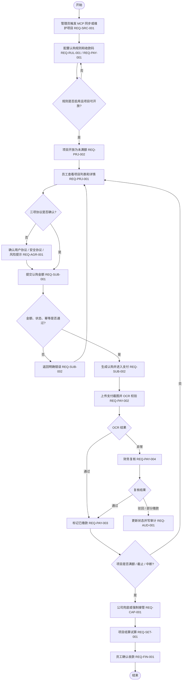

# 内部资金认购平台 PRD

## 1. 文档信息

| 字段 | 内容 |
|---|---|
| 文档类型 | PRD（Product Requirements Document，产品需求文档） |
| 产品名称 | 内部资金认购平台 |
| 当前版本 | v1.0 |
| 生成日期 | 2026-07-09 |
| 项目路径 | `/Users/phoenix/Documents/众筹6-自己的自动开发skill` |
| 当前实现 | Vue（前端框架）+ Element Plus（前端组件库）+ Node.js API（服务端接口）+ JSON（结构化数据文件）本地 MVP |
| 关联规格 | `docs/02-需求规格说明书.md` |
| 关联测试 | `docs/05-测试用例.md`、`tests/smoke.mjs` |

## 2. 背景与问题

公司内部采购 / 销售项目存在员工参与认购、线下缴款、财务复核、项目结算、公司兜底等多角色协作场景。如果仍依赖线下沟通、表格记录和人工核对，会出现以下问题：

- 员工无法实时判断项目是否还能认购、剩余金额是多少、认购后是否已缴款和是否可确认收款。
- 管理员难以统一控制项目开放、认购规则、最低金额、收款码、中断原因和返款通知。
- 财务需要人工匹配支付截图、到账金额、OCR（Optical Character Recognition，光学字符识别）结果、发票和结算结果，异常链路不易追溯。
- 公司兜底、强制接管、固定认购金额、收益归属和风险事件缺少统一台账。
- 审计日志、权限边界、幂等提交、防超卖等控制点若不系统化，会直接影响资金类业务的可信度。

本 PRD 基于当前项目实现反推，用于后续与后端、前端、测试、财务和管理层对齐，不把本地 mock（模拟）能力误认为生产能力。

## 3. 产品目标

### 3.1 北极星目标

完成“项目同步 / 创建 → 规则配置 → 项目开放 → 员工认购 → 支付 OCR → 财务复核 → 公司兜底 → 项目结算 → 员工确认收款 → 审计追踪”的端到端闭环，使本地 MVP 可作为生产化研发和测试验收的规格基线。

### 3.2 成功指标

| 指标 | 目标值 | 说明 |
|---|---:|---|
| 核心链路覆盖率 | 100% | 员工、管理员、财务、公司超级管理员四类角色均有可操作页面 |
| 关键动作审计覆盖率 | 100% | 创建认购、规则变更、项目开放 / 中断、支付复核、强制接管均应写审计 |
| 幂等认购准确率 | 100% | 同一 `idempotencyKey`（幂等键）重复提交只返回同一认购记录 |
| 防超卖能力 | 本地单进程通过，生产待压测 | 当前 API 校验剩余可认购金额；生产需数据库事务和压测证明 |
| 本地验证通过率 | 100% | `npm test`（测试命令）和 `npm run build`（构建命令）通过 |

## 4. 范围

### 4.1 本期范围

| 模块 | 范围 |
|---|---|
| 员工端 | 项目列表、项目详情 / 认购、我的认购、支付收款码与 OCR、确认收款 |
| 项目管理端 | 项目管理、MCP 同步模拟、认购规则配置、项目收款码管理、项目开放 / 终止 / 中断 |
| 财务端 | 支付复核、部分缴款、复核驳回、项目结算、发票 OCR 模拟 |
| 公司超级管理员端 | 公司兜底管理、权限管理、审计日志、风险事件、强制接管 |
| 系统能力 | API、本地 JSON 持久化、审计日志、风险事件、冒烟测试 |

### 4.2 非目标

- 本期不接入真实 PostgreSQL（关系型数据库）或生产数据库。
- 本期不接入真实登录、SSO（Single Sign-On，单点登录）、OAuth（开放授权）或企业身份。
- 本期不接入真实 MCP（Model Context Protocol，模型上下文协议）、真实 OCR、真实支付网关和真实对象存储。
- 本期不承诺 500+ 并发认购无超卖，必须在数据库事务和压测完成后才能验收。
- 本期不输出最终法务协议，协议文本仅作为业务流程占位和评审材料。

## 5. 用户与权限

| 角色 | 当前账号示例 | 目标诉求 | 主要页面 |
|---|---|---|---|
| 员工 | `employee01` | 查看项目、确认协议、提交认购、上传支付截图、查看收益、确认收款 | 项目列表、项目详情 / 认购、我的认购、支付收款码与 OCR |
| 管理员 | `admin01` | 同步项目、配置规则、开放 / 中断项目、维护收款码、查看审计 | 项目管理、认购规则配置、项目收款码管理、权限管理、审计日志 |
| 财务 | `finance01` | 核验到账、处理 OCR 异常、驳回或标记部分缴款、执行结算试算 | 项目收款码管理、支付复核、项目结算 |
| 公司超级管理员 | `superadmin01` | 管控兜底、强制接管、审计追踪、风险事件和权限矩阵 | 项目管理、公司兜底管理、权限管理、审计日志 |
| 系统任务 | `system` | 同步项目、归一化状态、记录系统审计 | API 后台任务 |

生产环境必须把当前前端角色切换替换为真实认证和后端接口级 RBAC（Role-Based Access Control，基于角色的访问控制）。

## 6. 信息架构

## 7. 核心业务流程

## 8. 页面需求

### 8.1 项目列表

| 项目 | 要求 |
|---|---|
| 使用角色 | 员工 |
| 关联需求 | REQ-PRJ-001 |
| 核心字段 | 项目名称、来源、状态、进度、剩余可认购金额、总额、截止时间、参与人数 |
| 核心操作 | 状态筛选、关键字搜索、排序、分页、进入详情 |
| 业务规则 | 只有 `未满额` 项目允许继续认购；`已中断` 项目需显示中断原因和返款提醒 |
| 验收标准 | 能按状态和关键字定位项目；进入详情后展示金额、协议和认购入口 |

### 8.2 项目详情 / 认购

| 项目 | 要求 |
|---|---|
| 使用角色 | 员工 |
| 关联需求 | REQ-AGR-001、REQ-SUB-001、REQ-SUB-002 |
| 核心字段 | 项目总额、剩余金额、最低认购金额、截止时间、收益预估、协议列表 |
| 核心操作 | 查看协议、勾选协议、输入认购金额、提交认购 |
| 业务规则 | 必须确认用户协议、安全协议、风险提示；金额不得低于最低认购额，不得超过剩余金额；提交必须携带 `idempotencyKey` |
| 验收标准 | 成功提交后生成认购记录；重复幂等键不生成第二条记录 |

### 8.3 我的认购

| 项目 | 要求 |
|---|---|
| 使用角色 | 员工 |
| 关联需求 | REQ-SUB-001、REQ-FIN-001 |
| 核心字段 | 认购编号、项目名称、认购金额、支付状态、收益预估、操作 |
| 核心操作 | 筛选项目 / 状态 / 金额、进入支付、确认收款 |
| 业务规则 | 仅 `待确认收款` 状态允许确认收款；超时未缴款需展示明确状态 |
| 验收标准 | 确认收款后状态变为 `已收款`，审计日志记录操作 |

### 8.4 支付收款码与 OCR

| 项目 | 要求 |
|---|---|
| 使用角色 | 员工 |
| 关联需求 | REQ-PAY-002、REQ-PAY-003 |
| 核心字段 | 认购金额、支付凭证、OCR 识别金额、识别状态 |
| 核心操作 | 上传支付截图、触发 OCR、查看识别结果 |
| 业务规则 | OCR 通过则标记已缴款；金额不一致进入待复核；识别失败提示重新上传 |
| 验收标准 | 支付状态在“我的认购”和“支付复核”中保持一致 |

### 8.5 项目管理

| 项目 | 要求 |
|---|---|
| 使用角色 | 管理员、公司超级管理员 |
| 关联需求 | REQ-SRC-001、REQ-PRJ-002、REQ-RISK-001 |
| 核心字段 | 项目编号、名称、状态、成本金额、销售金额、利润、剩余金额、规则、截止时间 |
| 核心操作 | MCP 同步、开放项目、终止项目、中断认购、查看认购、跳转复核 / 结算 |
| 业务规则 | 开放项目必须绑定当前项目的已启用规则；中断必须填写原因；中断后写风险事件并提示 48h 返款 |
| 验收标准 | 状态流转符合 `未开放 → 未满额 → 已满额 / 已截止 / 已中断 / 已完结` |

### 8.6 认购规则配置

| 项目 | 要求 |
|---|---|
| 使用角色 | 管理员 |
| 关联需求 | REQ-RUL-001 |
| 核心字段 | 规则编号、项目、规则名称、开放认购金额、公司固定认购金额、最低认购金额、最低参与人数、收款码、是否允许多次认购、是否公司兜底、状态 |
| 核心操作 | 创建、查看、编辑、启用、停用、删除、按项目 / 状态 / 关键字筛选 |
| 业务规则 | 有真实用户认购的规则不可修改关键配置、停用或删除；公司固定认购金额必须小于项目成本金额 |
| 验收标准 | 规则列表默认展示；创建后刷新列表并写审计；锁定规则返回 409 或前端禁用操作 |

### 8.7 项目收款码管理

| 项目 | 要求 |
|---|---|
| 使用角色 | 管理员、财务 |
| 关联需求 | REQ-PAY-001 |
| 核心字段 | 收款主体、账户说明、收款码名称、状态、更新人、更新时间、禁用原因 |
| 核心操作 | 创建收款码、启用 / 禁用、筛选 |
| 业务规则 | 禁用收款码不可用于新规则；生产环境需保存文件、主体资质和变更审计 |
| 验收标准 | 可为规则选择启用中的收款码；禁用动作有原因和操作记录 |

### 8.8 支付复核

| 项目 | 要求 |
|---|---|
| 使用角色 | 财务 |
| 关联需求 | REQ-PAY-004 |
| 核心字段 | 认购编号、项目、员工、认购金额、OCR 金额、上传时间、到账时间、复核人、复核时间、驳回原因 |
| 核心操作 | 复核通过、复核驳回、标记部分缴款 |
| 业务规则 | 仅 `待复核` 状态可复核；驳回必须填写原因；部分缴款需进入后续补缴 / 退款策略 |
| 验收标准 | 复核后支付状态、操作按钮、审计日志同步更新 |

### 8.9 项目结算

| 项目 | 要求 |
|---|---|
| 使用角色 | 财务、公司超级管理员 |
| 关联需求 | REQ-SET-001 |
| 核心字段 | 成本金额、销售金额、手续费、利润、员工认购、公司固定认购、公司强制接管金额、发票 OCR 结果 |
| 核心操作 | 结算试算、发票 OCR 模拟、查看分配结构 |
| 业务规则 | 结算结果必须区分员工、公司固定认购、公司兜底 / 强制接管金额 |
| 验收标准 | 调用结算试算后返回收入、成本、手续费和利润；页面展示可核对 |

### 8.10 公司兜底管理

| 项目 | 要求 |
|---|---|
| 使用角色 | 公司超级管理员 |
| 关联需求 | REQ-CAP-001 |
| 核心字段 | 项目剩余可认购金额、公司固定认购金额、公司强制接管金额、未缴款员工金额 |
| 核心操作 | 强制接管剩余额度 |
| 业务规则 | 仅 `未满额` 项目支持强制接管；无剩余额度不可接管 |
| 验收标准 | 接管后项目状态、剩余金额、公司强制接管金额和审计日志同步更新 |

### 8.11 权限管理、审计日志、风险事件

| 项目 | 要求 |
|---|---|
| 使用角色 | 管理员、财务、公司超级管理员 |
| 关联需求 | REQ-RBAC-001、REQ-AUD-001、REQ-RISK-001 |
| 核心字段 | 权限矩阵、操作时间、操作人、角色、动作、对象、前后状态、结果、风险等级、风险描述 |
| 核心操作 | 查看权限矩阵、筛选审计日志、查看风险事件 |
| 业务规则 | 权限矩阵不允许空白；关键资金动作必须审计；中断和 OCR 异常必须进入风险追踪 |
| 验收标准 | 审计日志可追溯关键动作；风险事件可定位项目和处置状态 |

## 9. 接口需求

| Method（请求方法） | Endpoint（接口地址） | 中文说明 | 关联需求 | 当前状态 |
|---|---|---|---|---|
| `GET` | `/api/health` | 健康检查 | REQ-OPS-001 | 已实现 |
| `GET` | `/api/state` | 调试状态读取 | REQ-OPS-001 | 已实现 |
| `GET` | `/api/projects` | 项目列表 | REQ-PRJ-001 | 已实现 |
| `GET` | `/api/rules` | 认购规则列表与筛选 | REQ-RUL-001 | 已实现 |
| `GET` | `/api/subscriptions` | 认购列表 | REQ-SUB-001 | 已实现 |
| `GET` | `/api/audit-logs` | 审计日志 | REQ-AUD-001 | 已实现 |
| `GET` | `/api/risk-events` | 风险事件 | REQ-RISK-001 | 已实现 |
| `GET` | `/api/rbac` | 权限矩阵 | REQ-RBAC-001 | 已实现 |
| `POST` | `/api/mcp/sync` | MCP 同步模拟 | REQ-SRC-001 | 已实现 |
| `POST` | `/api/subscriptions` | 创建认购 | REQ-SUB-001、REQ-SUB-002 | 已实现 |
| `POST` | `/api/subscriptions/:id/confirm-receipt` | 员工确认收款 | REQ-FIN-001 | 已实现 |
| `POST` | `/api/subscriptions/:id/review` | 财务复核 | REQ-PAY-004 | 已实现 |
| `POST` | `/api/rules` | 创建认购规则 | REQ-RUL-001 | 已实现 |
| `POST` | `/api/rules/:id/update` | 编辑认购规则 | REQ-RUL-001 | 已实现 |
| `POST` | `/api/rules/:id/status` | 启用 / 停用规则 | REQ-RUL-001 | 已实现 |
| `POST` | `/api/rules/:id/delete` | 删除规则 | REQ-RUL-001 | 已实现 |
| `POST` | `/api/projects/:id/open` | 开放项目 | REQ-PRJ-002 | 已实现 |
| `POST` | `/api/projects/:id/terminate` | 终止项目 | REQ-PRJ-002 | 已实现 |
| `POST` | `/api/projects/:id/interrupt` | 中断项目 | REQ-PRJ-002、REQ-RISK-001 | 已实现 |
| `POST` | `/api/payments/ocr` | 支付 OCR 模拟 | REQ-PAY-002 | 已实现 |
| `POST` | `/api/settlements/calc` | 结算试算 | REQ-SET-001 | 已实现 |
| `POST` | `/api/takeovers/:id/force` | 强制接管 | REQ-CAP-001 | 已实现 |

## 10. 数据字段

### 10.1 Project（项目）

| 字段 | 中文说明 | 规则 |
|---|---|---|
| `id` | 项目编号 | 唯一，不可重复 |
| `title` | 项目名称 | 必填 |
| `source` | 项目来源 | MCP 同步、手工创建、Mock 数据 |
| `status` | 项目状态 | `未开放`、`未满额`、`已满额`、`已截止`、`已中断`、`已完结` |
| `remain` | 剩余可认购金额 | 不得小于 0 |
| `total` | 开放认购总额 | 不得大于项目成本金额 |
| `costAmount` | 项目成本金额 | 生产需来自权威项目 / 采购系统 |
| `salesAmount` | 项目销售金额 | 用于结算试算 |
| `profitAmount` | 项目利润金额 | 由销售金额和成本金额推导 |
| `companyFixedAmount` | 公司固定认购金额 | 必须小于项目成本金额 |
| `companyForcedTakeoverAmount` | 公司强制接管金额 | 强制接管后增加 |
| `deadline` | 截止时间 | 用于认购和缴款期限判断 |

### 10.2 Subscription（认购记录）

| 字段 | 中文说明 | 规则 |
|---|---|---|
| `id` | 认购编号 | 系统生成 |
| `projectId` | 项目编号 | 必须关联存在项目 |
| `userId` | 员工账号 | 当前本地默认为 `employee01` |
| `amount` | 认购金额 | 不低于最低认购额，不超过剩余金额 |
| `pay` | 支付状态 | `未缴款`、`待复核`、`已缴款`、`部分缴款`、`复核驳回`、`待确认收款`、`已收款` |
| `idempotencyKey` | 幂等键 | 同一键只允许一条记录 |
| `createdAt` | 创建时间 | 系统生成 |
| `paymentDeadlineAt` | 缴款截止时间 | 当前创建后 12 小时 |
| `reviewedBy` | 复核人 | 财务复核后写入 |
| `rejectReason` | 驳回原因 | 复核驳回时必填 |

### 10.3 SubscriptionRule（认购规则）

| 字段 | 中文说明 | 规则 |
|---|---|---|
| `id` | 规则编号 | 系统生成 |
| `projectId` | 项目编号 | 必须关联存在项目 |
| `ruleName` | 规则名称 | 必填 |
| `totalAmount` | 开放认购金额 | 由项目成本金额减公司固定认购金额推导 |
| `companyFixedAmount` | 公司固定认购金额 | 不得小于 0，且小于项目成本金额 |
| `minAmount` | 最低认购金额 | 由开放认购金额和最低参与人数推导 |
| `minParticipants` | 最低参与人数 | 不低于 1 |
| `receivingCodeId` | 收款码编号 | 必填 |
| `allowMultiple` | 是否允许多次认购 | 布尔值 |
| `companyTakeover` | 是否允许公司兜底 | 布尔值 |
| `status` | 规则状态 | `未启用`、`已启用`、`已停用` |

## 11. 异常与边界

| 场景 | 处理规则 | 错误码 / 表现 |
|---|---|---|
| 项目不存在 | 拒绝操作 | `PROJECT_NOT_FOUND` |
| 项目不是未满额 | 不允许创建认购 | `PROJECT_NOT_SUBSCRIBABLE` |
| 未确认协议 | 不允许认购 | `AGREEMENT_REQUIRED` |
| 缺少幂等键 | 不允许认购 | `IDEMPOTENCY_KEY_REQUIRED` |
| 金额低于最低值 | 不允许认购 | `AMOUNT_TOO_SMALL` |
| 金额超过剩余额度 | 不允许认购 | `INSUFFICIENT_REMAINING_AMOUNT` |
| 规则缺少收款码 | 不允许保存 | `RECEIVING_CODE_REQUIRED` |
| 已有真实认购的规则被修改 | 不允许修改 / 停用 / 删除 | `RULE_LOCKED_BY_SUBSCRIPTION` 或 `OPEN_PROJECT_RULE_LOCKED` |
| 开放项目未选择规则 | 不允许开放 | `RULE_REQUIRED` |
| 中断项目未填写原因 | 不允许中断 | `INTERRUPT_REASON_REQUIRED` |
| 复核驳回未填写原因 | 不允许驳回 | `REJECT_REASON_REQUIRED` |
| 非待复核状态执行复核 | 不允许复核 | `SUBSCRIPTION_STATUS_INVALID` |
| 非未满额项目强制接管 | 不允许接管 | `PROJECT_NOT_FORCE_TAKEOVERABLE` |

## 12. 验收标准

| 编号 | 验收项 | 通过标准 |
|---|---|---|
| AC-001 | 员工认购闭环 | 员工可从项目列表进入详情，确认三项协议，提交认购，并在我的认购看到记录 |
| AC-002 | 幂等认购 | 同一 `idempotencyKey` 连续提交只生成一条认购记录 |
| AC-003 | 防超卖 | 认购金额超过剩余额度时被拒绝 |
| AC-004 | 规则配置 | 管理员可创建、筛选、启用规则；锁定规则不可改删 |
| AC-005 | 项目开放 | 未开放项目必须绑定已启用规则后才能开放为未满额 |
| AC-006 | 项目中断 | 中断必须填写原因，项目变为已中断，并生成风险事件和返款提示 |
| AC-007 | OCR 支付 | OCR 通过、金额不一致、识别失败三类结果能驱动支付状态变化 |
| AC-008 | 财务复核 | 财务可通过、驳回、标记部分缴款；驳回必须填写原因 |
| AC-009 | 强制接管 | 公司超级管理员可接管未满额项目剩余额度，并写审计 |
| AC-010 | 结算试算 | 财务可看到收入、成本、手续费、利润和分配结构 |
| AC-011 | 审计追踪 | 关键动作可在审计日志中看到操作人、角色、动作、对象和结果 |
| AC-012 | 本地验证 | `npm test` 和 `npm run build` 通过 |

## 13. 测试建议

| 测试类型 | 重点 |
|---|---|
| 功能测试 | 项目列表、认购、规则、支付复核、结算、强制接管 |
| 异常测试 | 超额认购、重复幂等键、规则锁定、无原因中断、无原因驳回 |
| 权限测试 | 员工不能改规则、管理员不能复核支付、财务不能强制接管 |
| 性能测试 | 项目列表响应小于 500ms；生产需 500+ 并发认购无超卖 |
| E2E 测试 | 员工认购、管理员开放项目、财务复核、超级管理员接管的浏览器链路 |

## 14. 生产化差距

| 差距 | 当前状态 | 生产化要求 |
|---|---|---|
| 数据库 | `data/dev-state.json` 本地文件 | PostgreSQL 表结构、迁移、事务、索引、备份 |
| 认证 | 前端角色切换 | SSO / OAuth / 企业身份登录、后端会话 |
| 权限 | 页面级模拟和 `/api/rbac` 展示 | 接口级 RBAC、越权拒绝、越权审计 |
| MCP | 本地同步模拟 | 真实 MCP 客户端、重试、幂等、失败不覆盖有效数据 |
| OCR | 本地模拟结果 | 真实 OCR 服务、置信度阈值、人工复核队列 |
| 支付 | 线下转账 + 截图模拟 | 支付流水、回调验签、对账、退款 |
| 文件 | 前端上传模拟 | 对象存储、访问控制、病毒扫描、生命周期 |
| 审计 | 本地 JSON 审计 | 不可篡改审计、索引、保留周期 |
| 并发 | 单进程校验 | 数据库事务、行锁 / 乐观锁、压测报告 |

## 15. 待确认事项

- 协议文本、亏损承担、本金退回、收益预期是否需要法务定稿。
- 公司固定认购、公司兜底、强制接管后的收益归属和审批权限。
- 部分缴款的后续动作：补缴、退款、自动取消还是人工处理。
- 项目来源系统的权威字段、字段覆盖规则和同步失败处理策略。
- 员工端最终入口是 PC 管理台、移动 H5、企业微信 / 飞书工作台，还是多端并存。
- 生产环境金额是否统一以“分”为最小单位存储。

## 16. 关联文档与证据

| 类型 | 路径 / 命令 |
|---|---|
| SRS（软件需求规格说明书） | `docs/02-需求规格说明书.md` |
| 功能清单 | `docs/02-功能清单.md` |
| 路线图 | `docs/03-优先级与路线图.md` |
| API 契约 | `docs/04-设计/API契约.md` |
| 测试用例 | `docs/05-测试用例.md` |
| 验收报告 | `docs/07-验收报告.md` |
| 落地实施文档 | `docs/08-落地实施文档.md` |
| 前端代码 | `src/App.vue`、`src/styles.css` |
| API 代码 | `server/server.ts` |
| 本地数据 | `data/dev-state.json` |
| 自动化验证 | `npm test`、`npm run build` |

