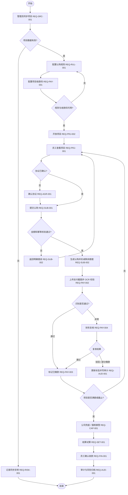

# 02-需求规格说明书

## 1. 引言

### 1.1 目的

本文是内部资金认购平台本地 MVP 的 SRS（Software Requirements Specification，软件需求规格说明书），用于统一产品、研发、测试、财务和管理层对功能范围、数据、权限、非功能指标和验收标准的理解。

### 1.2 范围

覆盖本地 Vue + Node.js API 版本已经实现或明确预留的业务能力，包括项目同步、项目管理、员工认购、支付 OCR、财务复核、公司兜底、项目结算、权限矩阵、审计日志和风险事件。

### 1.3 读者对象

产品经理、前端研发、后端研发、测试工程师、财务负责人、项目管理员、公司管理层。

### 1.4 术语表

| 术语 | 中文说明 |
|---|---|
| MVP | Minimum Viable Product，最小可用产品 |
| API | Application Programming Interface，应用程序接口 |
| MCP | Model Context Protocol，模型上下文协议 |
| OCR | Optical Character Recognition，光学字符识别 |
| RBAC | Role-Based Access Control，基于角色的访问控制 |
| idempotencyKey | 幂等键，用于避免重复提交生成重复认购 |
| JSON | JavaScript Object Notation，结构化数据文件格式 |

### 1.5 参考资料

- 当前前端实现：`src/App.vue`
- 当前样式实现：`src/styles.css`
- 当前 API 实现：`server/server.ts`
- 当前本地数据：`data/dev-state.json`
- 当前冒烟测试：`tests/smoke.mjs`
- 当前实施说明：`docs/08-落地实施文档.md`

## 2. 总体描述

### 2.1 产品定位

平台用于公司内部资金认购业务的流程化管理，先完成本地可运行 MVP，再逐步生产化为真实数据库、真实身份、真实外部系统同步、真实支付与文件存储。

### 2.2 用户画像

| 用户 | 使用场景 | 关键成功条件 |
|---|---|---|
| 员工 | 参与内部认购并查看个人收益 | 能清楚看到项目风险、剩余额度、缴款状态和收款确认入口 |
| 管理员 | 维护项目、规则、收款码和项目生命周期 | 能控制项目开放、中断和规则变更，且关键动作留痕 |
| 财务 | 复核支付、发票和结算 | 能准确识别异常、处理部分缴款、输出结算结果 |
| 超级管理员 | 管控权限、兜底和风险 | 能追踪风险事件、查看权限矩阵、执行强制接管 |

### 2.3 运行环境

- 前端：Vue 3 + Vite + Element Plus。
- 服务端：Node.js + 原生 HTTP API。
- 数据：`data/dev-state.json` 本地文件。
- 测试：`npm run test:smoke` 和 `npm run build`。

### 2.4 设计与实现约束

- 核心认购流程不依赖真实数据库和外部服务；项目管理页可选调用真实采购系统分页只读接口，失败时独立降级。
- 金额单位在页面展示为 RMB/CNY（人民币），当前数据以数字金额存储。
- 当前角色权限为前端模拟和接口返回矩阵，生产必须改为后端鉴权。
- 当前接口未做生产级身份校验，不得直接部署到公网。

### 2.5 假设与依赖

- 项目来源系统能提供项目编号、金额、截止时间、成本、销售额等基础字段。
- 财务能提供收款码、到账核验规则、发票核验规则。
- 管理层会确认公司兜底、强制接管和收益归属规则。

## 3. 业务流程

## 4. 功能需求

| 编号 | 名称 | 描述 | 输入 | 处理逻辑 | 输出 | 验收标准 | 优先级 |
|---|---|---|---|---|---|---|---|
| REQ-SRC-001 | 采购订单项目同步 | 管理员可触发真实采购订单拉取与安全映射 | 同步请求 | 服务端携带认证访问固定分页条件，按外部编号幂等创建或更新未开放项目，保护已有规则与认购 | 拉取、新增、更新、跳过数量与项目列表 | 调用 `/api/mcp/sync` 后有效订单出现在项目管理列表；失败或受保护项目不被覆盖 | P0 |
| REQ-PRJ-001 | 项目列表与详情 | 员工可筛选、排序并查看项目详情 | 状态、关键字、页码 | 按条件过滤项目，展示剩余额度、进度、截止时间 | 项目卡片 / 表格 / 详情 | `未满额` 项目可进入认购入口，异常状态不可认购 | P0 |
| REQ-PRJ-002 | 项目生命周期管理 | 管理员可开放、终止、中断项目 | 项目编号、规则编号、中断原因 | 校验规则状态和项目状态，更新项目状态并审计 | 项目状态更新 | 开放项目必须绑定启用规则；中断必须填写原因 | P0 |
| REQ-RUL-001 | 认购规则配置 | 管理员可创建、查看、编辑、启停、删除规则 | 项目、总额、最低认购额、参与人数、时间 | 校验金额、时间、项目绑定和锁定状态 | 规则记录 | 启用规则可用于开放项目；已有真实认购的规则不可随意改删 | P0 |
| REQ-PAY-001 | 收款码管理 | 管理员 / 财务维护项目收款码 | 主体、账户说明、收款码名称 | 创建、启用、禁用收款码 | 收款码列表 | 禁用收款码不可再用于新规则 | P0 |
| REQ-AGR-001 | 协议确认 | 员工认购前必须确认用户协议、安全协议和风险提示 | 三项协议勾选 | 未全选时阻止认购 | 协议确认状态 | 未确认三项协议时提交按钮不可完成认购 | P0 |
| REQ-SUB-001 | 创建认购 | 员工提交项目认购金额 | 项目编号、用户、金额、协议确认、幂等键 | 校验项目可认购、金额范围、协议确认 | 认购记录 | 成功后生成认购记录并显示在我的认购 | P0 |
| REQ-SUB-002 | 防超卖与幂等 | 防止超过剩余额度和重复提交 | 金额、`idempotencyKey` | 同键返回同一认购；金额超过剩余额度拒绝 | 成功或错误信息 | 冒烟测试验证同一幂等键只生成一条记录 | P0 |
| REQ-PAY-002 | 支付 OCR 模拟 | 员工上传截图后触发 OCR 校验 | 认购编号、金额、模拟状态 | 返回识别通过 / 金额不一致 / 失败 | 支付状态 | 识别异常进入待复核 | P0 |
| REQ-PAY-003 | 支付状态更新 | 系统更新未缴款、待复核、已缴款等状态 | OCR 结果或财务复核结果 | 按状态机更新认购记录 | 支付状态 | 状态在我的认购和财务复核页一致 | P0 |
| REQ-PAY-004 | 财务支付复核 | 财务可通过、驳回、部分缴款 | 认购编号、复核结果、备注 | 更新支付状态、复核人、复核时间、驳回原因 | 复核结果 | 复核后记录从待复核列表移除或状态变更 | P0 |
| REQ-CAP-001 | 公司兜底 / 强制接管 | 超级管理员可接管剩余可认购金额 | 项目编号 | 将剩余额度计入公司强制接管金额并更新项目进度 | 项目金额变化 | 调用 `/api/takeovers/:id/force` 后剩余额度为 0 或状态变化明确 | P0 |
| REQ-SET-001 | 项目结算试算 | 财务查看成本、销售额、利润和分配 | 项目编号 | 汇总员工认购、公司固定认购、兜底金额 | 结算明细 | 页面展示成本、销售额、利润和发票 OCR 模拟结果 | P0 |
| REQ-FIN-001 | 员工确认收款 | 员工对待确认收款记录进行确认 | 认购编号 | 更新为已收款并写审计 | 已收款状态 | 调用确认接口后我的认购状态为已收款 | P0 |
| REQ-RBAC-001 | 权限矩阵 | 展示角色与功能权限关系 | 角色和功能 | 返回权限矩阵 | 权限表 | 权限矩阵无空白单元格 | P0 |
| REQ-AUD-001 | 审计日志 | 记录关键动作 | 操作人、角色、动作、对象、前后状态 | 追加审计日志 | 审计记录 | 项目、规则、支付、兜底动作可追溯 | P0 |
| REQ-RISK-001 | 风险事件 | 记录中断、OCR 异常等风险 | 风险等级、描述、状态 | 追加风险事件 | 风险列表 | 中断项目和支付异常可在风险事件中追踪 | P1 |
| REQ-OPS-001 | 本地运行与测试 | 提供构建、冒烟测试和运行说明 | npm 命令 | 执行 API、前端、构建、测试 | 通过 / 失败结果 | `npm run build` 和 `npm test` 可执行 | P0 |

## 5. 数据需求

### 5.1 核心实体

| 实体 | 关键字段 | 中文说明 |
|---|---|---|
| Project | `id`、`title`、`status`、`remain`、`total`、`deadline` | 项目基础信息 |
| Subscription | `id`、`projectId`、`userId`、`amount`、`pay`、`idempotencyKey` | 员工认购记录 |
| SubscriptionRule | `id`、`projectId`、`totalAmount`、`minAmount`、`status` | 认购规则 |
| AuditLog | `time`、`actor`、`role`、`action`、`target`、`before`、`after`、`result` | 审计日志 |
| RiskEvent | `time`、`level`、`desc`、`status` | 风险事件 |

### 5.2 枚举

| 字段 | 枚举值 |
|---|---|
| 项目状态 | `未开放`、`未满额`、`已满额`、`已截止`、`已中断`、`已完结` |
| 支付状态 | `未缴款`、`部分缴款`、`已缴款`、`待复核`、`复核驳回`、`待确认收款`、`已收款` |
| 规则状态 | `未启用`、`已启用`、`已停用` |
| 角色 | `employee`、`admin`、`finance`、`super_admin`、`system` |

### 5.3 校验规则

- 认购金额必须大于等于项目规则最低认购额。
- 认购金额不得超过项目剩余可认购金额。
- 创建认购必须确认三项协议。
- 同一 `idempotencyKey` 重复提交必须返回同一条认购记录。
- 项目中断必须填写中断原因。
- 规则启用前必须满足项目、总额、最低认购额、参与人数、起止时间等必要字段。

## 6. 权限需求

| 功能 \ 角色 | 员工 | 管理员 | 财务 | 公司超级管理员 | 系统任务 |
|---|---|---|---|---|---|
| 项目列表 / 详情 | R | R | R | R | R |
| 创建认购 | C/R(本人) | — | — | — | — |
| 我的认购 | R/U(本人确认收款) | — | — | — | — |
| MCP 同步 | — | C/R | — | R | C/R |
| 项目开放 / 终止 / 中断 | — | C/R/U | — | R/U | — |
| 认购规则配置 | — | C/R/U/D | R | R | — |
| 收款码管理 | — | C/R/U | C/R/U | R | — |
| 支付复核 | — | R | C/R/U | R | — |
| 项目结算 | — | R | C/R/U | R | — |
| 公司兜底 / 强制接管 | — | R | R | C/R/U | — |
| 权限矩阵 | — | R | R | C/R/U | — |
| 审计日志 | R(本人相关) | R | R | R | C/R |
| 风险事件 | — | R | R | C/R/U | C/R |

## 7. 非功能需求

| 编号 | 类型 | 需求 | 验收标准 |
|---|---|---|---|
| NFR-001 | 性能 | 本地项目列表查询响应应低于 500ms | 本地 API 在开发数据量下响应成功 |
| NFR-002 | 并发 | 生产需支持 500+ 用户并发认购且无超卖 | 后续压测报告和数据库事务测试通过 |
| NFR-003 | 安全 | 生产必须后端鉴权、接口级 RBAC、敏感操作审计 | 越权接口返回拒绝且写审计 |
| NFR-004 | 可用性 | 本地 API 和前端应可独立启动 | `npm run api`、`npm run dev` 可运行 |
| NFR-005 | 可测试性 | 核心 API 至少有冒烟测试 | `npm test` 通过 |
| NFR-006 | 可追溯 | 关键业务动作必须有审计记录 | 审计日志可查询操作人、动作、对象、结果 |

## 8. 附录

### 8.1 原型 / 实现入口

- 本地前端默认地址：`http://127.0.0.1:5174/`
- 本地 API 默认地址：`http://127.0.0.1:4100`

### 8.2 当前 API 索引

详见 `docs/04-设计/API契约.md`。

### 8.3 变更记录

| 日期 | 版本 | 变更 |
|---|---|---|
| 2026-07-08 | v1.0 | 基于当前本地实现和 SDAD（规格驱动的代理式交付）流程补齐 SRS |
