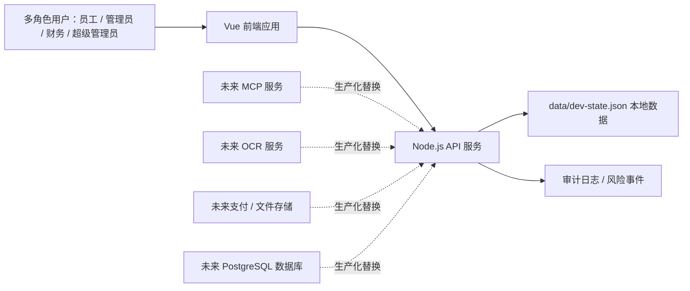

# HLD-概要设计

HLD（High-Level Design，概要设计）用于描述系统边界、模块关系和主要运行链路。

## 1. 系统边界

## 2. 模块划分

| 模块 | 当前文件 / 接口 | 说明 |
|---|---|---|
| 前端工作台 | `src/App.vue` | 多角色导航、页面状态、表单和交互 |
| 样式系统 | `src/styles.css` | 管理后台视觉样式 |
| API 服务 | `server/server.ts` | HTTP API、业务校验、状态持久化 |
| 本地数据 | `data/dev-state.json` | 项目、认购、规则、审计、风险事件 |
| 冒烟测试 | `tests/smoke.mjs` | 健康检查、状态读取、规则查询、认购幂等 |

## 3. 数据流

1. 前端通过 `fetch` 调用 `/api/*` 接口。
2. API 读取内存状态并按业务规则修改。
3. 修改类接口写回 `data/dev-state.json`。
4. 关键动作追加审计日志。
5. 前端重新加载或局部更新页面数据。

## 4. 生产化替换点

| 当前实现 | 替换目标 | 替换原因 |
|---|---|---|
| JSON 文件 | PostgreSQL | 支持事务、并发、索引、备份 |
| 前端角色切换 | SSO / OAuth / 企业身份 | 防止越权和伪造角色 |
| 模拟 MCP | 真实 MCP 客户端 | 获取真实项目来源 |
| 模拟 OCR | OCR 服务 + 人工复核队列 | 提升财务核验准确性 |
| 页面模拟上传 | 对象存储 | 文件权限、病毒扫描、生命周期管理 |

