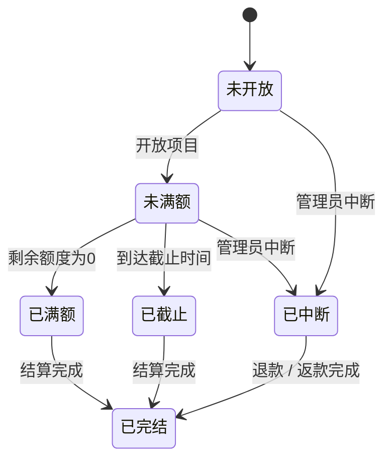
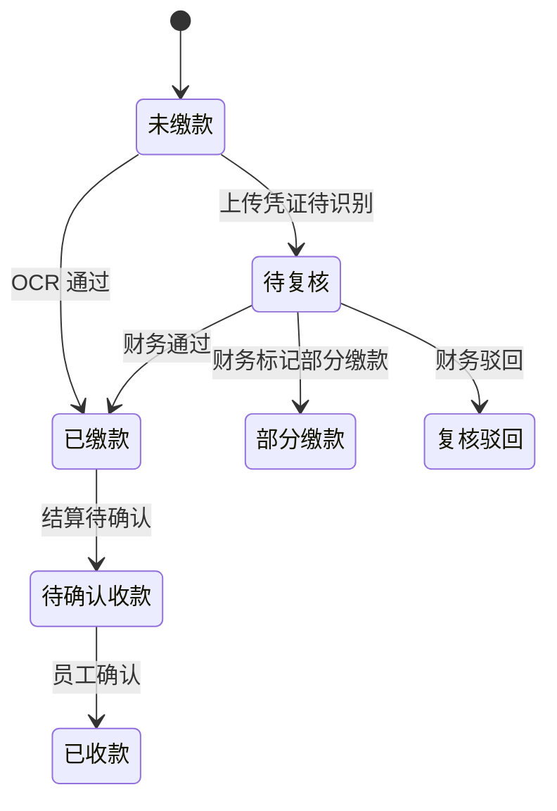

# LLD-详细设计

LLD（Low-Level Design，详细设计）用于约束接口、状态机、校验规则和异常处理。

## 1. 状态机

### 1.1 项目状态机

### 1.2 认购支付状态机

## 2. 关键校验

| 场景 | 校验 |
|---|---|
| 创建认购 | 项目必须为 `未满额`；金额大于等于最低认购额；金额不超过剩余额度；协议已确认 |
| 幂等提交 | 同一 `idempotencyKey` 返回同一认购记录 |
| 开放项目 | 必须选择 `已启用` 规则 |
| 中断项目 | 必须填写中断原因；写风险事件和审计日志 |
| 财务复核 | 只处理待复核或异常支付记录；结果必须为通过 / 驳回 / 部分缴款之一 |
| 强制接管 | 项目必须存在剩余额度；接管后更新公司强制接管金额 |

## 3. 错误处理

| 错误 | 返回 / 表现 |
|---|---|
| 接口路径不存在 | HTTP 404 |
| 请求体不是合法 JSON | HTTP 400 |
| 项目不存在 | HTTP 404 或业务错误提示 |
| 金额非法 | HTTP 400，提示金额范围 |
| 规则锁定 | HTTP 409，提示已有认购不可修改 |
| 幂等重复 | HTTP 200，返回既有记录 |

## 4. 持久化

当前 `server/server.ts` 启动时读取 `data/dev-state.json`，修改后写回同一文件。测试脚本会备份并恢复该文件，避免冒烟测试污染本地数据。

## 5. 生产数据表建议

| 表名 | 中文说明 |
|---|---|
| `projects` | 项目表 |
| `subscription_rules` | 认购规则表 |
| `subscriptions` | 认购记录表 |
| `payments` | 支付凭证和复核表 |
| `settlements` | 结算表 |
| `audit_logs` | 审计日志表 |
| `risk_events` | 风险事件表 |
| `receiving_codes` | 收款码表 |

