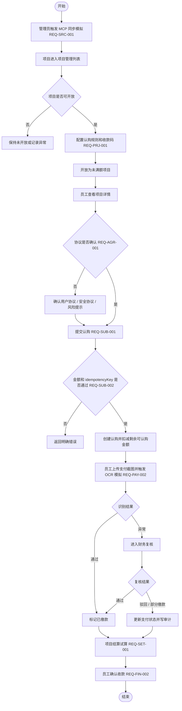

# 08-落地实施文档

## 1. 文档目的

本文基于当前项目代码、API（Application Programming Interface，应用程序接口）、本地数据和自动化测试生成，用于指导后续研发、测试、验收和生产化改造。

当前项目路径：`/Users/phoenix/Documents/众筹6-自己的自动开发skill`。

当前定位：内部资金认购平台本地 MVP（Minimum Viable Product，最小可用产品）。系统已经从静态 HTML（HyperText Markup Language，超文本标记语言）原型推进到可运行的 Vue（前端框架）+ Node.js API（服务端接口）实现，并已接入真实采购订单分页拉取及订单到未开放项目的安全映射；仍未接入真实 PostgreSQL（关系型数据库）、全量分页同步、OCR（Optical Character Recognition，光学字符识别）、生产认证、支付和文件存储。

## 2. 当前交付状态

| 类别 | 当前结论 | 证据路径 / 命令 |
|---|---|---|
| 前端 | 已实现本地 MVP 页面 | `src/App.vue` |
| 样式 | 已实现后台管理界面样式 | `src/styles.css` |
| API | 已实现本地 Node.js API | `server/server.ts` |
| 数据 | 已实现本地 JSON 持久化 | `data/dev-state.json` |
| 自动化测试 | 已实现 smoke test（冒烟测试） | `tests/smoke.mjs`、`npm run test:smoke` |
| 构建 | 已配置生产构建 | `npm run build` |
| 截图证据 | 已有历史浏览器验证证据 | `.playwright-cli/page-*.png`、`.playwright-cli/page-*.yml` |

## 3. 本地运行方式

### 3.1 安装依赖

```bash
npm install
```

### 3.2 启动 API

```bash
npm run api
```

默认地址：`http://127.0.0.1:4100`。

健康检查：

```bash
curl http://127.0.0.1:4100/api/health
```

预期结果：返回 `ok=true` 和 `service=subscription-api`。

### 3.3 启动前端

```bash
npm run dev -- --host 127.0.0.1 --port 5174
```

默认访问地址：`http://127.0.0.1:5174/`。

### 3.4 构建与测试

```bash
npm run build
npm test
```

当前 `npm test` 等价于 `npm run test:smoke`，用于校验 API 健康、状态读取、规则查询、认购幂等和测试数据恢复。

## 4. 角色与页面范围

| 角色 | 当前页面 | 已落地能力 |
|---|---|---|
| 员工 | 项目列表、项目详情、我的认购、支付 OCR | 查看项目、筛选排序、确认协议、创建认购、上传截图模拟、确认收款 |
| 管理员 | 项目管理、认购规则配置、项目收款码管理 | 真实采购订单分页同步与未开放项目映射、开放 / 终止 / 中断项目、规则创建 / 编辑 / 删除、收款码启停 |
| 财务 | 支付复核、项目结算 | 复核通过 / 驳回 / 部分缴款、结算试算、发票 OCR 模拟 |
| 公司超级管理员 | 公司兜底、权限矩阵、审计日志、风险事件 | 强制接管剩余可认购金额、查看权限矩阵、审计追踪和风险事件 |
| 系统任务 | API 模拟 | MCP 同步、状态归一化、本地数据持久化 |

当前左侧菜单会隐藏部分只应从业务入口进入的页面，例如支付复核和项目结算，但页面仍可通过项目管理按钮跳转。

## 5. 核心业务闭环



## 6. API 落地范围

| Method（请求方法） | Endpoint（接口地址） | 中文说明 | 当前状态 |
|---|---|---|---|
| `GET` | `/api/health` | 健康检查 | 已实现 |
| `GET` | `/api/state` | 调试状态读取 | 已实现 |
| `GET` | `/api/projects` | 项目列表 | 已实现 |
| `GET` | `/api/rules` | 认购规则列表与筛选 | 已实现 |
| `GET` | `/api/subscriptions` | 认购列表 | 已实现 |
| `GET` | `/api/audit-logs` | 审计日志 | 已实现 |
| `GET` | `/api/risk-events` | 风险事件 | 已实现 |
| `GET` | `/api/rbac` | 权限矩阵 | 已实现 |
| `POST` | `/api/mcp/sync` | 真实采购订单分页拉取与项目幂等映射 | 已实现 |
| `POST` | `/api/subscriptions` | 创建认购并校验幂等 | 已实现 |
| `POST` | `/api/subscriptions/:id/confirm-receipt` | 员工确认收款 | 已实现 |
| `POST` | `/api/subscriptions/:id/review` | 财务复核支付 | 已实现 |
| `POST` | `/api/rules` | 创建认购规则 | 已实现 |
| `POST` | `/api/rules/:id/update` | 编辑草稿规则 | 已实现 |
| `POST` | `/api/rules/:id/status` | 启用 / 停用规则 | 已实现 |
| `POST` | `/api/rules/:id/delete` | 删除草稿规则 | 已实现 |
| `POST` | `/api/projects/:id/open` | 开放项目认购 | 已实现 |
| `POST` | `/api/projects/:id/terminate` | 终止项目认购 | 已实现 |
| `POST` | `/api/projects/:id/interrupt` | 中断认购并写风险事件 | 已实现 |
| `POST` | `/api/payments/ocr` | OCR 支付校验模拟 | 已实现 |
| `POST` | `/api/settlements/calc` | 结算试算 | 已实现 |
| `POST` | `/api/takeovers/:id/force` | 公司强制接管剩余可认购金额 | 已实现 |

## 7. 数据现状

当前本地数据文件：`data/dev-state.json`。

| 数据对象 | 当前数量 | 说明 |
|---|---:|---|
| 项目 | 20 | 覆盖未开放、未满额、已满额、已截止、已中断、已完结 |
| 认购规则 | 5 | 含未启用、启用、停用等规则状态 |
| 认购记录 | 38 | 覆盖未缴款、待复核、已缴款、复核驳回、待确认收款、已收款 |
| 审计日志 | 52 | 覆盖项目、规则、支付、兜底等关键动作 |
| 风险事件 | 3 | 覆盖中断、OCR 异常等本地风险样例 |

这些数据只用于本地开发和验收，不代表生产数据。

## 8. 需求追溯矩阵

| 需求编号 | 中文说明 | 当前落地 | 主要证据 |
|---|---|---|---|
| REQ-SRC-001 | 采购订单项目同步 | 固定第一页拉取、分转元映射、幂等创建更新与业务保护已实现 | `POST /api/mcp/sync`、`server/procurement.ts`、`server/procurement-project.ts`、项目管理页 |
| REQ-PRJ-001 | 项目展示与规则 | 已实现本地 MVP | 项目列表、项目详情、认购规则配置 |
| REQ-AGR-001 | 协议确认 | 已实现本地 MVP | 协议弹窗、协议抽屉、认购前置勾选 |
| REQ-SUB-001 | 创建认购 | 已实现本地 MVP | `POST /api/subscriptions` |
| REQ-SUB-002 | 防超卖与幂等 | 单进程模拟实现 | `idempotencyKey` 校验、`tests/smoke.mjs` |
| REQ-PAY-001 | 收款码与截图上传 | 本地交互模拟 | 项目收款码管理、支付页 |
| REQ-PAY-002 | OCR 支付校验 | 本地模拟实现 | `POST /api/payments/ocr`、支付复核页 |
| REQ-PAY-003 | 网页支付宝支付预留 | 字段预留 | 支付方式扩展边界 |
| REQ-CAP-001 | 公司兜底 / 强制接管 | 部分实现 | `POST /api/takeovers/:id/force` |
| REQ-SET-001 | 结算分润 | 本地试算实现 | `POST /api/settlements/calc`、项目结算页 |
| REQ-FIN-001 | 合同发票管理 | 范围调整 | 独立菜单移除，结算页保留发票 OCR 模拟 |
| REQ-FIN-002 | 打款与收款确认 | 已实现本地 MVP | `POST /api/subscriptions/:id/confirm-receipt` |
| REQ-RBAC-001 | 权限控制 | 页面级模拟 | `/api/rbac`、角色切换 |
| REQ-AUD-001 | 审计日志 | 已实现本地 MVP | `/api/audit-logs` |
| REQ-NOT-001 | 通知系统 | 预留 | 当前以页面消息和风险事件为主 |
| REQ-RISK-001 | 风险事件 | 已实现本地 MVP | `/api/risk-events` |
| REQ-OPS-001 | 性能与可用性 | 部分验证 | `npm run build`、`npm test`；500 并发待压测 |

## 9. 当前测试策略

### 9.1 已有自动化测试

| 命令 | 覆盖范围 | 当前定位 |
|---|---|---|
| `npm run test:smoke` | API 健康、状态读取、规则查询、认购幂等、数据恢复 | 最小自动化验收 |
| `npm test` | 当前等价于 `npm run test:smoke` | 默认测试入口 |
| `npm run build` | TypeScript（类型语言）检查和 Vite（构建工具）生产构建 | 构建验收入口 |

`tests/smoke.mjs` 会自动选择临时 API 端口，并在测试结束后恢复 `data/dev-state.json`，避免污染本地开发数据。

### 9.2 待补测试

| 测试类型 | 目标 | 建议优先级 |
|---|---|---|
| E2E（End-to-End，端到端）浏览器测试 | 覆盖员工认购、规则配置、支付复核、结算跳转 | P0 |
| API 集成测试 | 覆盖错误码、状态流转、规则锁定、强制接管 | P0 |
| 并发压测 | 验证 500 并发认购无超卖 | P0 |
| 权限测试 | 验证生产 RBAC 接口级拒绝 | P0 |
| 回归截图测试 | 对关键页面做视觉回归 | P1 |

## 10. 生产化差距

| 差距 | 当前状态 | 生产化要求 |
|---|---|---|
| 数据库 | 本地 JSON 文件 | PostgreSQL 表结构、迁移、事务、索引、备份 |
| 认证 | 前端角色切换 | SSO（Single Sign-On，单点登录）/ OAuth（开放授权）/ 企业身份登录和后端会话 |
| 权限 | 页面级隐藏和矩阵展示 | 接口级 RBAC、越权审计、敏感操作二次校验 |
| MCP / 采购系统 | 已实现固定第一页真实拉取、字段映射与幂等同步 | 补全量分页、令牌轮换、重试与监控 |
| OCR | 模拟状态 | 真实 OCR 服务、置信度阈值、人工复核闭环 |
| 支付 | 线下转账模拟 | 真实支付流水、回调验签、对账 |
| 文件 | 页面模拟上传 | 对象存储、病毒扫描、权限隔离 |
| 性能 | 构建和冒烟测试 | 压测报告、容量模型、监控告警 |
| 审计 | 本地 JSON 审计 | 不可篡改审计、查询索引、保留周期 |

## 11. 后续路线图

| 阶段 | 范围 | 退出标准 |
|---|---|---|
| Now（当前阶段） | 稳定本地 MVP 文档、补 E2E 自动化、固化 API 错误码 | `npm run build`、`npm test`、E2E 关键链路通过 |
| Next（下一阶段） | PostgreSQL 数据层、真实认证、接口级 RBAC、API 集成测试 | 本地真实数据库联调通过，越权接口返回明确错误 |
| Later（远期阶段） | 真实 MCP、真实 OCR、真实支付、生产部署和监控 | 完成外部系统联调、压测、灰度验收和人工终审 |

## 12. 人工终审清单

- 协议文本、亏损承担、本金退回规则需法务或管理层复核。
- 公司固定认购、公司兜底、公司强制接管的收益归属需管理层确认。
- OCR 自动通过阈值和人工复核责任需财务负责人确认。
- 生产登录、权限、支付、文件存储、审计保留周期需安全负责人确认。
- 500 并发认购无超卖必须以压测报告作为验收证据。
