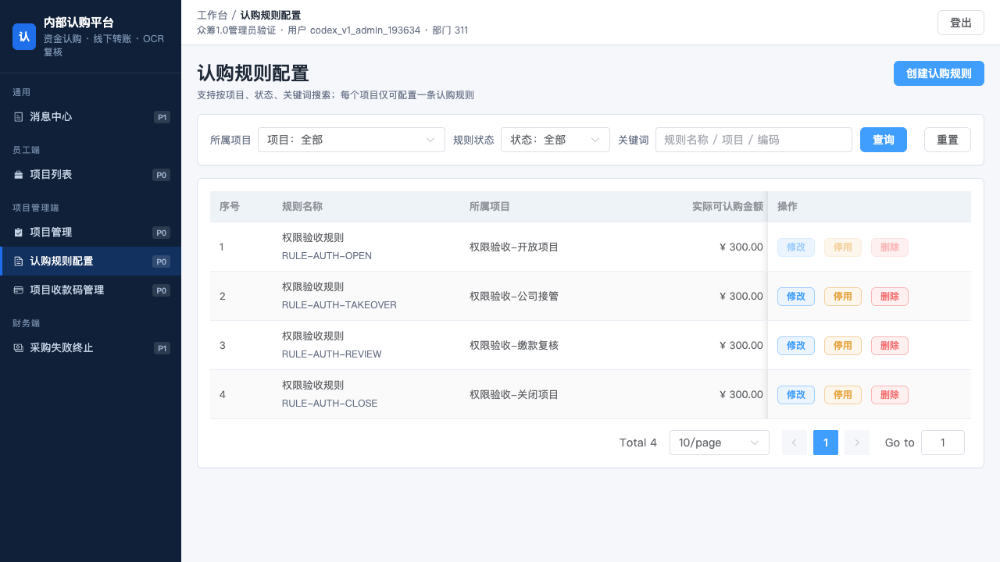
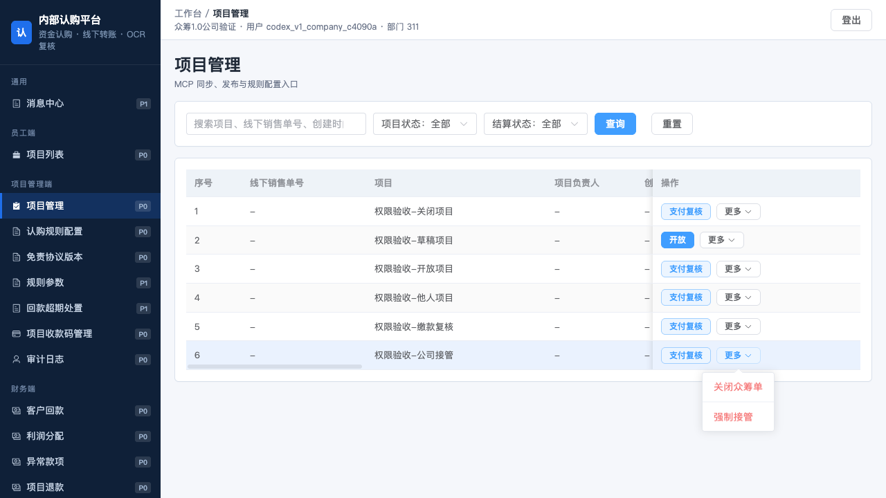
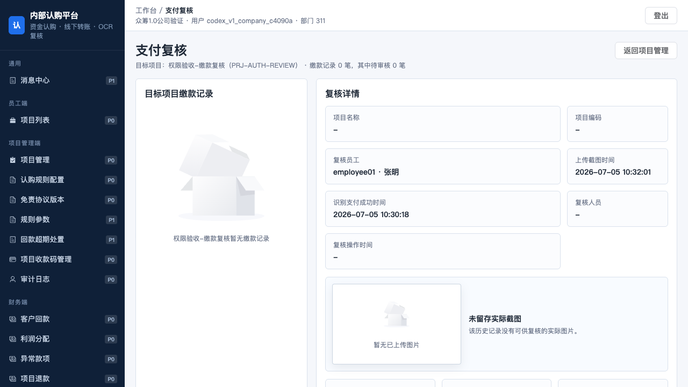
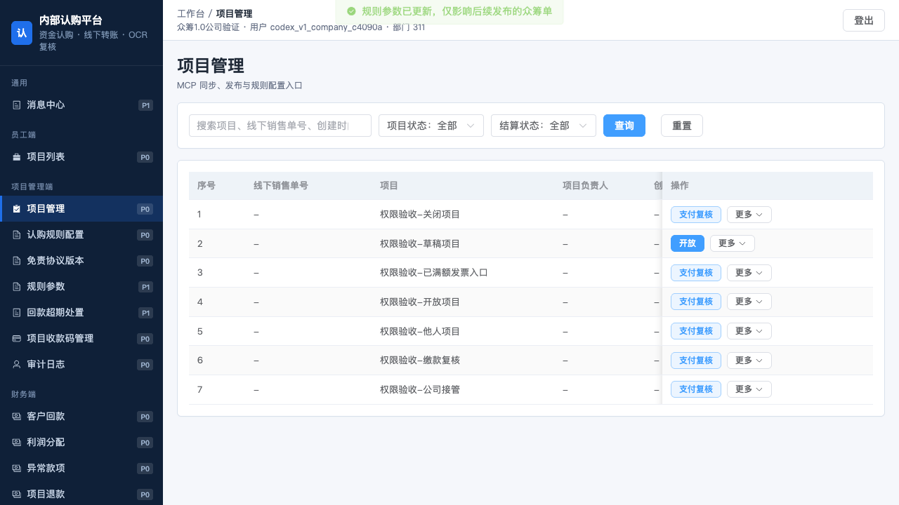
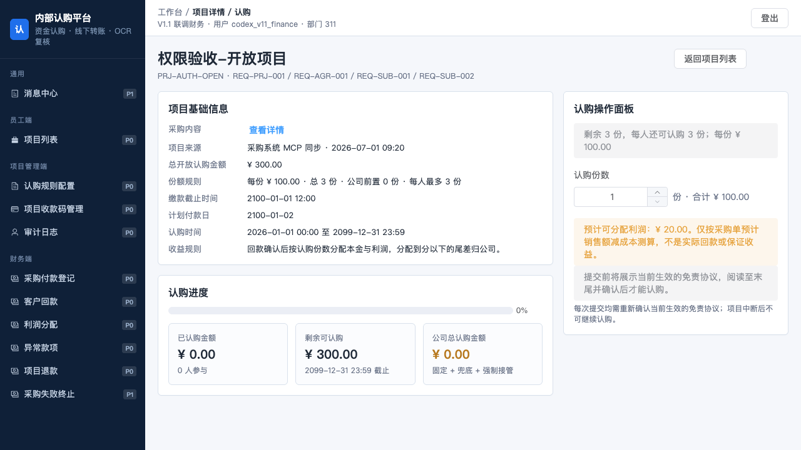
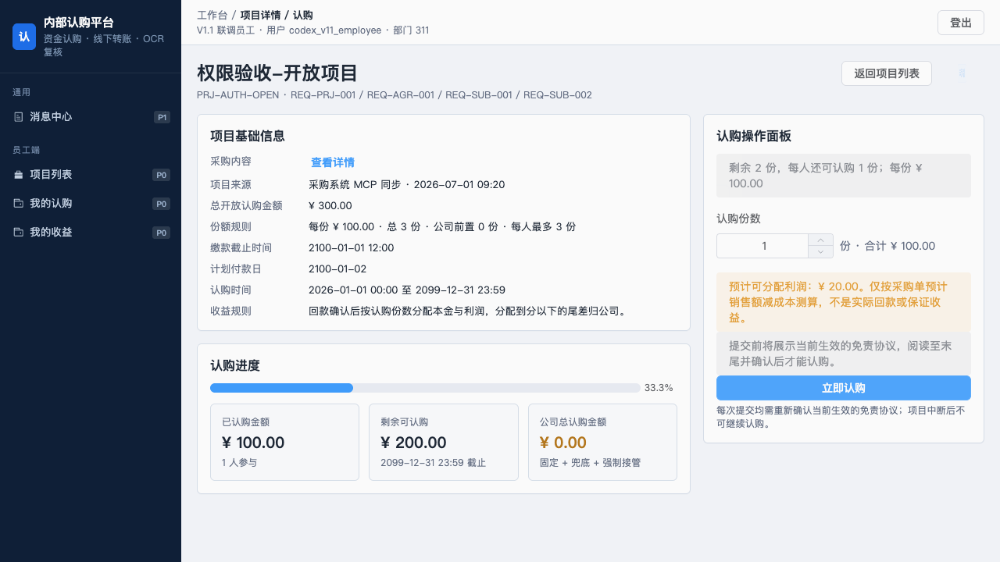

# 众筹1.0 四角色真实登录与权限生效验证报告

> 后续状态：本报告发现的AUTH-01至AUTH-05已修复，并完成四角色复验。最新结论见[五项权限修复与四角色复验](13-五项权限修复与四角色复验-2026-10-28.md)。下文保留修复前的历史验证记录。

日期：2026-10-28。项目目录：`/Users/phoenix/Documents/众筹v1.0`。IAM 客户端：`crowdfunding`；租户：`0`。本报告不涉及众筹2.0。

## 1. 验证结论

**真实登录、可见侧栏菜单、IAM 权限码分配与未授权 API 拦截通过；完整用户操作链未通过。** 本轮发现5项待修问题，涉及财务复核入口、发票核对入口、按份认购复核处理及两条缺失处理的注册路由，见第5节。本次验证没有修改业务代码，也没有为绕过缺陷扩大角色权限。

经用户明确同意，新建两个专用测试账号，分别只绑定现有项目管理员与公司超级管理员角色。没有创建审计角色，没有重置既有账号密码，没有变更其他客户端角色和授权。

## 2. 环境与方法

- 本地主服务：众筹1.0前端 `127.0.0.1:5174`、业务 API `127.0.0.1:4100`；监听进程工作目录均为本项目。IAM Web `5173`、API `8080` 健康检查通过。
- 四类账号均实际向真实 IAM 提交账号密码，通过 OAuth 授权码和 PKCE 完成登录；分别核对用户角色、permission-info（权限信息）、页面和按钮权限集合及数据范围。
- 使用 Playwright 独立浏览器会话，从众筹1.0主页面跳转到真实 IAM 登录页并返回，逐个点击可见侧栏菜单；没有预置令牌替代浏览器登录。
- 可见菜单与页面加载验证走当前主服务；写操作及含业务数据的按钮验证使用当前 `server/server.ts` 启动的随机端口服务与随机前缀 MongoDB 集合。浏览器通过真实请求转发访问该隔离业务 API，前端仍是当前众筹1.0，IAM 未模拟、后端响应未伪造。
- 隔离测试采购地址指向本机不可用端口，避免读取真实外部采购数据。采购同步返回502属于主动隔离上游后的边界结果，未作为采购业务成功。
- 所有写入都是隔离技术数据，不对应真实银行付款、法务协议发布或实际采购出资；不能据此签署资金业务全链路验收。

## 3. 四角色结果

| 角色 | 真实 IAM 登录及众筹回调 | 主服务可见菜单逐个打开 | IAM允许/拒绝码数量 | 数据范围 |
|---|---|---:|---|---|
| 员工 | 通过；业务 auth/me 为200 | 4/4 | 19允许 / 81拒绝 | 仅本人 |
| 项目管理员 | 通过；业务 auth/me 为200 | 6/6 | 22允许 / 78拒绝 | 全部；仍受业务归属与职责校验 |
| 财务 | 通过；业务 auth/me 为200 | 11/11 | 64允许 / 36拒绝 | 全部；仍受业务归属与职责校验 |
| 公司超级管理员 | 通过；业务 auth/me 为200 | 14/14 | 44允许 / 56拒绝 | 全部；仍受业务归属与职责校验 |

IAM 中财务有13个页面资源、公司有16个页面资源，其中各有两个上下文页面被侧栏隐藏，故实际可见菜单分别为11和14；不能把IAM资源数量直接当作实际侧栏菜单数量。

### 3.1 主服务实际可见菜单

- **员工**：消息中心、项目列表、我的认购、我的收益。
- **项目管理员**：消息中心、项目列表、项目管理、认购规则配置、项目收款码管理、采购失败终止。
- **财务**：消息中心、项目列表、认购规则配置、项目收款码管理、审计日志、采购付款登记、客户回款、利润分配、异常款项、项目退款、采购失败终止。
- **公司超级管理员**：消息中心、项目列表、项目管理、认购规则配置、免责协议版本、规则参数、回款超期处置、项目收款码管理、审计日志、客户回款、利润分配、异常款项、项目退款、采购失败终止。

35个可见侧栏入口均成功打开；本轮逐页检查未捕获页面脚本错误或菜单加载 API 的4xx/5xx。此结果不包含隐藏且不可达页面的通过结论。

### 3.2 数据归属与职责

- 员工 `/api/subscriptions` 只返回本人记录；伪造另一用户ID创建认购返回403。
- 项目管理员项目列表不包含他人已发布项目；对他人项目提交关闭返回404 `SCOPE_DENIED`。IAM 的 all 并未取消该业务归属检查。
- 财务和公司分别返回 all 数据范围，但公司不能创建认购规则、维护收款码或执行财务缴款复核；财务不能保存公司参数、发布协议、强制接管。
- 公司可从项目管理进入只读支付复核页面，页面不显示“通过/驳回”按钮；直接尝试财务动作同样被权限拒绝。

## 4. 验证覆盖和实际操作证据

| 验证层级 | 本轮结果 | 不应扩大解释为 |
|---|---|---|
| 四角色真实 IAM 权限判定 | 4×100=400次允许/拒绝判定与清单一致 | 400条业务流程均成功 |
| 业务 API 路由边界 | 107条路由×4角色=428次真实请求；247次未授权请求全部返回403权限拒绝，未发现放行 | 所有已授权请求都有合法业务数据并成功落库 |
| 未登录与伪造身份头 | 两项均返回401 | 已完成全部身份攻击面审计 |
| 主服务侧栏 | 35/35入口打开，菜单与清单一致，无页面脚本错误/加载失败 | 隐藏上下文页面均有可达入口 |
| 隔离浏览器关键按钮/入口 | 29项检查：26通过、3项入口问题；另3类按钮成功打开实际对话框 | 70个按钮的全部状态组合均已验证 |
| 合法写入/归属/角色交叉验证 | 35项：28通过、7项失败；失败归并为业务复核及两条缺失路由，见第5节 | 真实资金闭环已验收 |
| 复核问题重复复现 | 按份认购驳回和部分缴款均409，且原状态未变 | IAM拒绝授权 |
| 相关现有单测 | 前端权限、认证API客户端、数据范围18/18通过 | 可替代真实浏览器和业务接口验证 |

428次业务路由请求中，有效查询成功69次、进入业务校验96次、额外角色/确认条件拒绝9次、缺失路由404为6次、主动隔离采购上游导致502为1次、IAM拒绝247次。多条路由复用同一权限码；支付复核路由还要根据请求动作追加授权。空请求体触发的业务校验不算完整操作成功。

### 4.1 实际成功写入（均为隔离业务数据）

| 操作 | 角色 | 实际结果 |
|---|---|---|
| 本人创建按份认购 | 员工 | 201，记录中的用户为登录本人 |
| 创建规则 | 项目管理员 | 201 |
| 创建收款码记录 | 项目管理员、财务 | 各201；公司和员工均403 |
| 保存五项规则参数 | 公司 | API为200；另从浏览器点击“保存全部参数”也返回200并显示保存成功 |
| 强制接管剩余金额 | 公司 | 200；数据库项目已满额、剩余金额为0；其余三类角色403 |
| 新增测试协议版本 | 公司 | 201，新版本2落库；其余三类角色403 |

管理员“创建认购规则”、财务“创建收款码”、员工“立即认购”按钮均实际点击并打开对应对话框。仅打开对话框没有被记作提交成功；公司参数保存有浏览器提交与成功响应证据。

## 5. 发现的问题与复现方法

### AUTH-01 / P1：财务支付复核页面缺少用户可达入口

- IAM已给财务支付复核页面及通过、驳回、部分缴款 API 权限。
- 实际侧栏由 `src/App.vue:645` 的隐藏列表排除 payReview；财务又没有 adminProjects 菜单。
- 项目列表和项目详情没有财务支付复核入口；行内“支付复核”只出现在项目管理页（`src/App.vue:3060`）。
- 复现：财务真实登录，检查侧栏、项目列表、项目详情；找不到支付复核入口。不能把同名权限码已下发算作用户可用。
- 建议：为财务提供明确的复核菜单/业务入口，或经产品确认提供仅展示合法操作的项目工作台；不通过扩大写权限来解决导航问题。

### AUTH-02 / P1：财务及公司的发票核对页面缺少用户可达入口

- settlement 被隐藏为上下文页面。
- 财务没有项目管理菜单，无法使用其中“核对发票”入口。
- 公司虽能进入项目管理，但该行内入口要求 `settlement:upload-invoice`（`src/App.vue:3069`）；公司只读角色不应取得上传权限，因此已满额项目也不显示入口。
- 复现：公司登录、进入项目管理，选取已满额隔离项目；侧栏与行内均无发票核对入口。财务从当前菜单同样无法进入。
- 建议：查询入口使用查询权限判断，上传按钮再独立校验上传权限；财务提供实际可达入口。

### AUTH-03 / P1：财务按份认购“驳回/部分缴款”得到409

- 请求：财务真实令牌，`POST /api/subscriptions/SUB-AUTH-OTHER/review`，分别提交 `result=reject`（含有效驳回理由）和 `result=partial`。
- 测试记录在请求前为待复核且 `shares=1`；IAM允许具体复核动作，但服务端均返回409 `SUBSCRIPTION_STATUS_INVALID`，原记录仍待复核。
- 根因：`server/server.ts:4429` 仅对按份认购的 pass 分支专门处理；reject/partial进入旧处理分支，而 `server/server.ts:4517` 明确拒绝 `latest.shares !== undefined`。
- 建议：按份认购的驳回和部分缴款建立完整状态处理及事务保护。不得通过移除角色校验或直接删掉状态条件替代业务修复。

### AUTH-04 / P2：已注册的项目详情GET路由未实现

- 注册：`GET /api/projects/:id` 使用 project:query。
- 复现：四类真实令牌请求已存在的 `PRJ-AUTH-OPEN`，均404 `NOT_FOUND`；不是不存在的测试ID造成。
- 当前浏览器详情使用已加载的项目列表数据，因此页面能显示不代表这个API已实现。
- 建议：实现受数据范围控制的详情路由，或明确移除无效契约与资源说明。

### AUTH-05 / P2：已注册的收款码启用路由未实现

- 注册：`POST /api/receiving-codes/:id/enable` 与disable共用权限码。
- 复现：管理员使用有效令牌请求已有 `RC-AUTH`，404 `NOT_FOUND`；当前服务端未找到对应处理分支。
- 建议：实现启用操作和引用/状态校验，或明确该能力不提供并清理失效注册。

上述P1为用户流程/业务能力阻断。本轮未修改这些实现；主服务接口与隔离API一致使用当前项目代码，测试失败未被跳过或改写为通过。

## 6. 截图证据

### 管理员登录后的规则维护按钮

### 公司强制接管菜单

### 公司只读支付复核

### 公司已满额项目缺发票入口及参数保存成功

### 财务详情缺复核入口且无认购提交按钮

### 员工认购对话框

## 7. 清理与保留内容

- 四个专用浏览器会话均实际登出，响应204；随后关闭测试浏览器。
- 本轮API测试创建的8个访问/刷新令牌均已撤销，临时令牌文件已删除。
- 测试业务服务已停止，26个随机前缀MongoDB隔离集合已删除，无残留。
- 正式业务集合的名称及记录数量与本轮写入前快照一致。本轮没有向正式业务集合提交资金或状态写操作。
- 四角色既有授权、Redis投影与配置清单复核一致；其他客户端资源、角色及授权与之前配置快照一致。未修改众筹2.0。
- 既有业务代码和不相关未提交改动保留。

两个按用户指令新建的专用账号保留，密码不在本报告或聊天展示：

| 用途 | 用户ID | 本地凭据文件 | 文件权限 |
|---|---|---|---|
| 项目管理员 | 312 | `/Users/phoenix/.config/crowdfunding/iam-v11-admin-test-account.json` | 600 |
| 公司超级管理员 | 313 | `/Users/phoenix/.config/crowdfunding/iam-v11-company-test-account.json` | 600 |

## 8. 产物位置与复验范围

- 本报告：`/Users/phoenix/Documents/众筹v1.0/docs/12-四角色真实登录与权限生效验证-2026-10-28.md`。
- 浏览器截图（18张）：`/Users/phoenix/Documents/众筹v1.0/output/playwright/iam-permissions-20261028/`。
- 机器可读证据及执行脚本：`/Users/phoenix/Documents/众筹v1.0/.runtime/iam-permissions-20261028/`。主要结果文件：live-verification.json（登录及IAM判定）、各角色-browser.json（主服务菜单遍历）、各角色-isolation.json（关键按钮）、focused-company.json、api-verification.json（428条路由与两条身份边界）、functional-verification.json、review-reproduction.json、dialog-verification.json、browser-cleanup.json、cleanup-verification.json。
- 前一轮权限清单：`/Users/phoenix/Documents/众筹v1.0/docs/04-设计/众筹1.0-IAM权限配置清单.json`。
- 相关现有单测命令：`node --import tsx --test tests/frontend-permissions.test.ts tests/auth-api-client.test.ts tests/data-scope.test.ts`，18/18通过。

建议先修复AUTH-01至AUTH-03，再以同样四类真实账号复验入口、按份缴款三种复核结果及公司只读凭证流程；AUTH-04和AUTH-05补齐契约实现后再复验。全部缺口关闭前，不把本次报告表述为所有菜单、按钮和业务API已完整验收通过。
