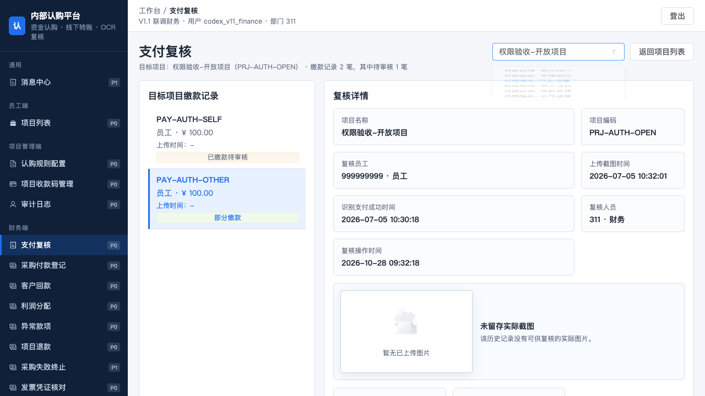
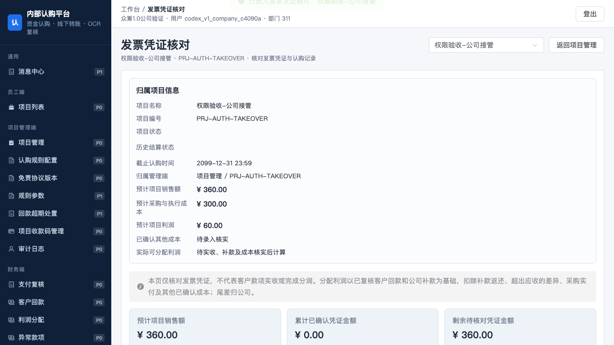
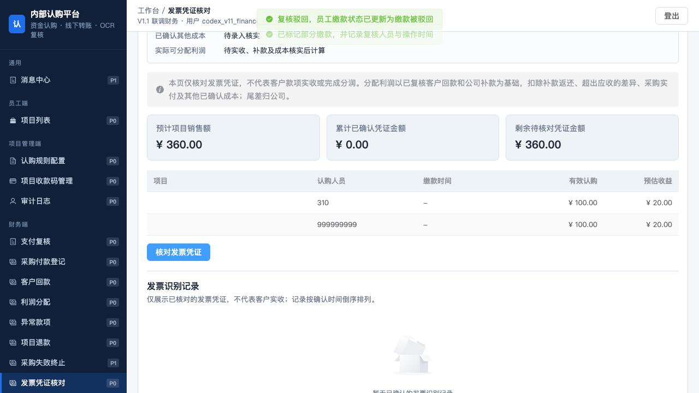
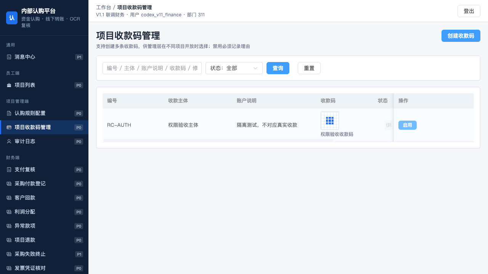

# 众筹1.0 五项权限问题修复与四角色复验

日期：2026-10-28。项目根目录：`/Users/phoenix/Documents/众筹v1.0`。IAM 客户端：`crowdfunding`；租户：`0`。

## 1. 结论

**上轮 AUTH-01 至 AUTH-05 共5项问题已修复，本轮四角色登录、菜单、关键按钮、API权限和数据范围复验通过。** 修复已在本地主服务运行，前端 `http://127.0.0.1:5174/`、API `http://127.0.0.1:4100`。

本轮仅修改众筹1.0。未改众筹2.0源代码；IAM配置快照确认其他客户端、角色、API资源及角色授权完全未变。既有员工、财务、项目管理员、公司测试账号被复用，没有重置密码、新建角色或扩大写权限。

“通过”限定为这5项缺陷与本报告列出的验证范围，不替代真实银行到账、采购、OCR外部服务、真实法务协议及生产资金全链路验收。

## 2. 五项修复对应关系

| 编号 | 修复 | 验证证据 | 结果 |
|---|---|---|---|
| AUTH-01 | 支付复核恢复为按IAM授权显示的独立菜单；增加项目选择器；返回按钮按当前角色回到可访问页面 | 财务真实登录可点击入口，选择项目并通过实际按钮完成驳回、部分缴款，响应均200 | 通过 |
| AUTH-02 | 发票凭证核对恢复独立菜单；行内入口检查查询权限；上传、确认分别检查其写权限；空项目显示空状态 | 财务、公司均可进入；公司已满额项目行显示查询入口，但无上传按钮；主服务空数据页无脚本错误 | 通过 |
| AUTH-03 | 按份认购的非通过复核允许进入状态更新事务；仍重查待复核、冻结和采购付款锁；不提前入账或释放份数 | API及浏览器真实驳回/部分缴款均200；事务落库；重复提交409；冻结409；空驳回理由400；份数不变、未新增资金台账 | 通过 |
| AUTH-04 | 实现GET /api/projects/:id，复用项目列表可见范围并校验管理员发布项目归属；补入受限管理员GET门禁 | 四角色对可见项目200；员工不可见/过期项目404；管理员他人已发布项目404；主服务新处理分支已核对 | 通过 |
| AUTH-05 | 实现POST /api/receiving-codes/:id/enable及授权按钮；状态修改与审计在同一事务；重复启用不重复审计 | 管理员、财务授权保持；财务实际点击启用返回200；员工/公司拒绝；重复启用审计仅1条；缺失记录404 | 通过 |

收款码启用只恢复同一账户/图片的启用状态，不绕过已有认购对图片替换的锁定；继续复用既有 receiving-code:disable 权限码，没有增加权限码。

独立只读审查还发现并修复两项新项目选择器边界：切换实际复核记录时清空金额及流水号；OCR进行中、凭证删除/提交进行中或存在待绑定发票资产时，禁用发票项目切换。前者另有真实浏览器核验，两项均经最终只读审查确认。

## 3. 四角色实测

| 角色 | 真实登录/业务auth/me | 可见侧栏逐项打开 | IAM API码允许/拒绝 | 数据范围 |
|---|---|---:|---|---|
| 员工 | 通过/200 | 4/4 | 19允许、81拒绝 | 仅本人 |
| 项目管理员 | 通过/200 | 6/6 | 22允许、78拒绝 | 全部，仍执行职责与业务归属校验 |
| 财务 | 通过/200 | 13/13 | 64允许、36拒绝 | 全部，仍执行职责与业务归属校验 |
| 公司超级管理员 | 通过/200 | 16/16 | 44允许、56拒绝 | 全部，仍执行职责与业务归属校验 |

### 3.1 实际菜单

- **员工**：消息中心、项目列表、我的认购、我的收益。
- **项目管理员**：消息中心、项目列表、项目管理、认购规则配置、项目收款码管理、采购失败终止。
- **财务**：消息中心、项目列表、认购规则配置、项目收款码管理、审计日志、支付复核、采购付款登记、客户回款、利润分配、异常款项、项目退款、采购失败终止、发票凭证核对。
- **公司超级管理员**：消息中心、项目列表、项目管理、认购规则配置、免责协议版本、规则参数、回款超期处置、项目收款码管理、审计日志、支付复核、客户回款、利润分配、异常款项、项目退款、采购失败终止、发票凭证核对。

四类浏览器会话均从众筹1.0跳转真实IAM登录页，经账号密码、授权码及PKCE返回；未预置令牌替代浏览器登录。39个菜单入口无页面脚本错误、无加载API失败。菜单显示同时受IAM菜单及UI权限控制，没有通过给财务项目管理写权限来修复导航。

### 3.2 权限与数据边界

- 员工仅查询本人认购；伪造认购人403。项目详情只提供与当前可认购项目列表相同的可见范围。
- 管理员仅可操作本人归属已发布项目；跨归属关闭404，未扩大部门范围写操作。
- 财务可以复核缴款，不能发布协议、保存公司参数或强制接管。
- 公司可以执行公司专属操作，不能创建规则、维护收款码或提交财务缴款复核；发票查询与上传权限分开。
- 所有金额、资金与状态写入验证均在随机前缀隔离集合中执行；浏览器转发到当前真实后端，IAM未模拟、响应未伪造。

## 4. 验证结果与证据边界

| 验证 | 结果 |
|---|---|
| 修复前失败回归 | 新后端集成用例先复现5个失败，再在修复后7/7通过；证据见backend-red.log和backend-green.log |
| 构建 | npm run build退出码0，包含后端类型检查、Vue类型检查及前端构建；仍有原有包体积提示 |
| 完整测试 | npm test退出码0：214项单测、既有IAM边界集成、最后一份并发认购集成、新增7项权限回归均通过 |
| 四角色IAM判定 | 100权限码×4角色=400次，分配与拒绝符合清单 |
| 业务路由边界 | 107路由×4角色=428次请求；247次未授权请求全部权限拒绝，无意外放行；另2项未登录/伪造身份头均401 |
| 主服务真实菜单 | 39/39逐个打开，无脚本错误或加载API错误 |
| 关键按钮/入口 | 四角色27项检查、财务/公司专项12项、实际启用按钮1项，共40项通过 |
| 合法操作与职责交叉 | 35/35通过，含本人认购、规则创建、复核、参数、协议、接管、启用、详情、越权拒绝及实际数据库结果 |
| 额外主服务核对 | 四角色auth/me均200且权限集合匹配；两个新增处理分支在当前4100服务中生效 |
| 范围对比 | 其他客户端和角色授权未变；原有6处不相关工作区差异完整保留 |

路由边界验证使用缺失资源或不完整业务参数时，正常返回400/404/409属于进入业务校验，不能当作该资金流程全部成功。采购同步上游主动隔离，返回502未计为采购业务成功。70个按钮的全部业务状态组合、真实OCR与银行收付款不在本轮全覆盖范围。

## 5. IAM与代码变更范围

- IAM只将crowdfunding下payReview、settlement两个现有菜单的visible改为0（显示），通过IAM持久化任务更新缓存。角色、API资源、角色菜单分配、角色API分配均未变；未修改众筹2.0客户端。
- 前端：`src/App.vue`，入口、查询/上传隔离、项目选择与空状态、复核输入重置、启用按钮。
- 后端：`server/server.ts`，项目详情、收款码启用事务及按份认购非通过复核。
- 测试：`tests/role-permission-regressions.integration.ts`；新增npm命令test:integration:permissions，并纳入npm test。
- 配置声明：`docs/04-设计/众筹1.0-IAM权限配置清单.json`及`scripts/iam-crowdfunding-v1-role-permissions.sql`同步两个菜单可见性。
- 原有未提交工作未覆盖，基线差异和两个业务文件副本保存在本轮.runtime目录的before/中。本轮未提交或推送Git提交。

## 6. 截图

### 财务支付复核与部分缴款结果

### 公司行内发票查询、无上传操作

### 财务发票核对独立入口

### 财务实际启用收款码

## 7. 清理与运行状态

- 四个测试浏览器实际登出，均204，随后关闭测试浏览器。
- API验证的8个访问/刷新令牌已撤销，临时令牌文件已删除。
- 随机端口业务服务停止；26个隔离集合删除，无残留；原业务集合名称和记录数量与本轮基线相同。
- 原四类测试账号保留；凭据仍位于`/Users/phoenix/.config/crowdfunding/`，没有在文档或聊天中展示密码。
- 本地主服务已按已验证的crowdfunding IAM配置重启并保持运行。原启动脚本不含该进程原先注入的IAM变量，本轮通过下述本地启动辅助脚本恢复API；IAM本身及其他项目服务未重启。

## 8. 文件位置

- 本报告：`/Users/phoenix/Documents/众筹v1.0/docs/13-五项权限修复与四角色复验-2026-10-28.md`。
- 新增回归测试：`/Users/phoenix/Documents/众筹v1.0/tests/role-permission-regressions.integration.ts`。
- 截图：`/Users/phoenix/Documents/众筹v1.0/output/playwright/iam-fix-20261028`。
- 执行脚本、JSON证据及日志：`/Users/phoenix/Documents/众筹v1.0/.runtime/iam-fix-20261028`。
- 当前机器可读配置清单：`/Users/phoenix/Documents/众筹v1.0/docs/04-设计/众筹1.0-IAM权限配置清单.json`。
- 声明式IAM配置SQL：`/Users/phoenix/Documents/众筹v1.0/scripts/iam-crowdfunding-v1-role-permissions.sql`。
- 本地API启动辅助脚本：`/Users/phoenix/Documents/众筹v1.0/.runtime/iam-fix-20261028/start-main.ts`。

主要证据：各角色-browser.json、各角色-isolation.json、focused-verification.json、enable-verification.json、functional-verification.json、api-verification.json、main-verification.json、iam-scope-verification.json、workspace-scope-verification.json、cleanup-verification.json，以及npm-test.log、build.log。新增回归命令：`npm run test:integration:permissions`。
