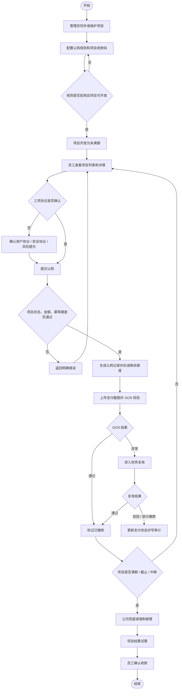

# 01-内部资金认购平台

## 1. 模块定位

内部资金认购平台用于承接公司内部采购 / 销售项目的员工认购、线下缴款、财务复核、公司兜底、项目结算和审计追踪。当前项目是本地 MVP（Minimum Viable Product，最小可用产品），实现形态为 Vue（前端框架）+ Element Plus（前端组件库）+ Node.js API（服务端应用程序接口）+ JSON（结构化数据文件）本地持久化。

当前代码路径：`/Users/phoenix/Documents/众筹6-自己的自动开发skill`。

## 2. 目标用户与入口

| 角色 | 当前账号示例 | 入口页面 | 用户目标 |
|---|---|---|---|
| 员工 | `employee01` | 项目列表、项目详情 / 认购、我的认购、支付收款码与 OCR | 查看项目、确认协议、提交认购、上传支付截图、确认收款 |
| 管理员 | `admin01` | 项目管理、认购规则配置、项目收款码管理、权限管理、审计日志 | 同步项目、配置规则、开放 / 中断项目、维护收款码、追踪审计 |
| 财务 | `finance01` | 项目收款码管理、支付复核、项目结算 | 核验到账、处理 OCR 异常、复核支付、试算结算 |
| 公司超级管理员 | `superadmin01` | 项目管理、公司兜底管理、权限管理、审计日志 | 管控强制接管、权限矩阵、风险事件和审计 |
| 系统任务 | `system` | 后台 API | 执行采购订单分页拉取、状态归一化、审计记录 |

## 3. 核心流程

## 4. 页面与用户可见行为

### 4.1 项目列表

- 员工可按项目状态、认购状态、认购笔数和关键字筛选项目。
- 项目卡片 / 表格展示项目名称、来源、状态、进度、剩余可认购金额、总额、截止时间和参与人数。
- 只有 `未满额` 项目允许进入可认购路径。
- `已中断` 项目需要展示中断原因和“已缴款金额将在 48h 内原路返款到账”的返款提醒。

### 4.2 项目详情 / 认购

- 员工进入详情后可查看项目金额、剩余额度、截止时间、收益预估和协议内容。
- 采购系统同步项目支持在当前页面查看真实采购订单详情；系统通过项目名称查询采购订单，并按同步外部编号精确匹配。
- 采购订单详情只读展示，查询失败不覆盖本地项目或认购数据；采购系统认证令牌仅由服务端持有。
- 员工提交认购前必须确认用户协议、安全协议和风险提示。
- 系统校验项目必须为 `未满额`、认购金额不能低于最低认购额、不能超过剩余可认购金额，并要求 `idempotencyKey`（幂等键）。
- 同一 `idempotencyKey` 重复提交时，返回同一条认购记录，不新增第二条。

### 4.3 我的认购

- 员工可查看本人认购记录、项目、金额、支付状态、收益预估和后续动作。
- 状态为 `待确认收款` 时，员工可确认收款。
- 确认收款后状态更新为 `已收款`，并写入审计日志。

### 4.4 支付收款码与 OCR

- 支付页按照当前认购记录所属项目及其已启用规则，精确展示规则绑定的启用收款码，不跨项目回退到其他收款码。
- 支付页在收款码上方展示当前认购对应的实际项目名称、项目编号、项目来源、项目成本金额、本次应付金额和认购规则，字段来自当前认购、项目及规则数据，不使用固定项目文案。
- 匹配成功后展示持久化的实际收款码图片、收款主体、收款码名称、账户说明和收款码编号；图片支持点击放大，无图片时展示明确提示并要求财务补传真实图片。
- 项目、规则或收款码配置不可用时展示明确空状态，员工需联系管理员或财务处理后再支付。
- 员工可上传实际支付截图，支持 PNG、JPG、WebP 格式且单张不超过 5MB；上传后显示真实图片并支持点击放大、重新选择替换。
- 同一认购支持连续上传多张支付截图，每张图片独立留存文件名、上传时间、识别金额和识别状态，不覆盖历史截图。
- 页面展示应付金额、累计 OCR 识别金额和剩余待识别金额；累计低于应付金额时为 `部分缴款` 并继续上传，等于应付金额时为 `已缴款` 并停止上传，超过应付金额时进入 `待复核`。
- 识别失败的图片仍留存但按 0 元计入累计值；员工可继续补传清晰截图。
- 支付截图明细与认购记录绑定并保存到当前本地后端状态，刷新页面后仍可查看；本地 MVP 通过“本张模拟识别金额”验证累计规则，生产环境由真实 OCR 结果替代。
- OCR（Optical Character Recognition，光学字符识别）通过时，支付状态更新为 `已缴款`。
- OCR 金额不一致时，支付状态进入 `待复核`。
- OCR 识别失败时，提示重新上传或进入人工处理。

### 4.5 项目管理

- 管理员可触发真实采购订单分页拉取；成功后看到拉取、新增、更新、跳过数量与采购系统总条数。
- 字段完整且成本有效的采购订单会按稳定外部编号映射为内部“未开放”项目，并显示在项目管理列表。
- 项目管理列表展示“项目负责人”；采购同步项目的负责人直接来自采购接口 `creator`（创建人）字段，缺失时显示“-”。
- 只有仍为“未开放”且没有规则、没有认购的已同步项目允许刷新字段；其他项目跳过。
- 已有规则、认购或非“未开放”状态的受保护采购项目再次同步时，允许单独补齐项目负责人，不覆盖项目名称、状态、金额、规则和认购数据。
- 拉取失败不得覆盖已有有效项目，也不得影响本地认购核心流程。
- 项目管理表格的“操作”列固定在右侧视窗，横向滚动时保持可见；按钮行为不变。
- 未开放项目仅展示“开放”和“更多”，不显示“支付复核”和“去结算”；其他项目状态显示“支付复核”“去结算”。“终止项目”和“强制接管”继续收纳到“更多”菜单，并保留原状态限制、危险提示和确认流程。
- 管理列表每行同时展示的操作超过 3 个时，按高频操作常驻、低频或危险操作收纳的原则重新排布；3 个及以下不强制折叠。
- 项目管理列表的结算状态按项目阶段派生：`未开放` 显示“未开放”，`未满额` 显示“未满额”，`已满额` 或 `已截止` 显示“待结算”，`已中断` 显示“已中断”，`已完结` 显示“已结算”；结算状态筛选使用相同口径。
- 项目管理列表每页固定展示 10 条；超过 10 条时提供分页，总数、页码与跨页序号保持一致。
- 搜索或状态筛选变化后返回第 1 页，排序针对完整筛选结果生效后再分页。
- 管理员可开放未开放项目，但必须绑定当前项目的已启用认购规则。
- 管理员从项目操作区进入支付复核时，系统携带该项目作为复核数据范围。
- 管理员可终止或中断项目；中断必须填写原因。
- 中断项目后状态变为 `已中断`，写入风险事件和审计日志。

### 4.6 认购规则配置

- 管理员可创建、查看、编辑、启用、停用、删除认购规则。
- 规则列表支持项目、状态和关键字筛选。
- 一个项目最多存在一条认购规则；创建规则时，已有任意状态规则的项目在所属项目下拉中保留显示、置灰且不可选，重复创建请求会被拒绝。
- 创建规则需要项目、规则名称、公司固定认购金额、最低参与人数、收款码、是否允许多次认购、是否允许公司兜底、起止时间。
- 有真实用户认购记录的规则不可修改关键配置、停用或删除。
- 公司固定认购金额必须小于项目成本金额；开放认购金额由项目成本金额减公司固定认购金额推导。
- 创建规则时，输入字段先于依赖它的推导金额展示，顺序为公司固定认购金额、开放认购金额、开放参与人数、单次认购最低金额。

### 4.7 项目收款码管理

- 管理员和财务可维护收款主体、账户说明、收款码名称和启停状态。
- 创建收款码时支持图片即时预览、重新选择和移除；列表及规则配置展示对应图片，无图片时显示默认占位图。
- 启用状态的已有收款码支持上传或更换真实图片，保存前可预览；图片仅支持 PNG、JPG/JPEG、WebP 且不超过 5MB。
- 员工支付页根据当前认购项目的已启用规则展示其绑定收款码的图片和具体字段；配置不可用时不展示其他项目的收款码。
- 收款码基本信息、状态和图片由本地 API 写入 `data/dev-state.json`，刷新后列表、规则配置和员工支付页继续展示同一图片。
- 禁用收款码不可用于新认购规则。
- 当前收款码管理使用本地 JSON 持久化并记录创建、图片更换和禁用审计；生产环境仍需要对象存储、数据库、主体资质、鉴权和访问审计。

### 4.8 支付复核

- 财务可处理 `待复核` 支付记录。
- 从项目管理进入后，页面明确显示目标项目名称、编号、缴款记录总数和待复核笔数；左侧队列展示该项目全部已发生支付活动的记录，兼容项目编号和历史项目名称关联，不跨项目回退。
- 缴款记录包括 `待复核`、`已缴款`、`部分缴款`、`复核驳回`、`待确认收款`、`已收款`；`未缴款`和`已释放`不进入本页。
- 每条队列记录展示支付单号、员工、金额、上传时间和当前状态；`待复核`记录可执行复核，其他状态展示截图及处理信息但保持只读。
- 完成一笔复核后优先选择同项目下一笔待复核记录；没有待复核记录时仍可查看该项目其他缴款记录，只有完全没有缴款记录时才显示项目空状态。
- 财务复核详情展示员工针对该认购实际上传的同一张支付截图并支持点击放大；历史记录无图时显示明确空状态，不生成模拟凭证。
- 一笔认购存在多张支付截图时，财务可逐张查看实际图片、文件名、上传时间、单张识别金额和累计 OCR 金额。
- 实际截图卡片根据详情区域可用宽度自动切换左右或上下布局；图片等比例缩放，长文件名和识别信息允许换行，卡片不产生横向溢出，并保留点击放大能力。
- 复核结果支持通过、驳回和部分缴款。
- 驳回必须填写原因。
- 复核后写入复核人、复核时间、支付状态和审计日志。

### 4.9 项目结算

- 财务可查看项目成本金额、销售金额、手续费、利润、员工认购金额、公司固定认购金额和公司强制接管金额。
- 结算试算返回收入、成本、手续费和利润。
- 结算认购明细逐笔展示项目、认购人员、缴款时间、有效认购和收益；认购人员来自真实用户编号并匹配现有员工名称，缴款时间优先使用支付成功时间，历史数据可回退到支付截图上传时间，均缺失时显示“-”。
- 发票上传入口默认隐藏；财务点击“发起结算”并在确认弹窗中确认后，页面才进入发票上传阶段并展示入口。取消或关闭弹窗时入口保持隐藏。
- “发起结算”确认只代表进入发票上传阶段；财务还需对 OCR 识别出的交易金额执行“确认结算”，确认成功后才累计结算金额并持久化发票摘要。
- 结算页展示项目销售收入、累计已确认结算金额与剩余待结算金额；本次交易金额必须大于 0 且不超过剩余待结算金额。
- 累计确认金额小于项目销售收入时，项目状态更新为“部分已结算”，发票上传入口保持开放，支持继续上传并确认下一张发票。
- 累计确认金额等于项目销售收入时，项目状态更新为“已完结”，发票上传入口关闭，不再允许继续上传。
- 相同幂等键重复确认不重复累计；每次有效确认写入审计日志。确认结算不代表打款清单已生成或员工已收到通知。
- 页面按“项目信息与金额汇总 → 认购明细与结算操作 → 上传发票 → 发票识别记录”的顺序展示；发票识别记录固定在页面最底部。
- 每次确认结算后，底部识别记录新增一条实际上传图片、文件名、交易日期、付款人、收款人、交易金额、确认时间、操作人、结算结果、确认后累计金额和剩余金额；记录按确认时间倒序排列，刷新后继续展示。
- 仅完成 OCR 但尚未确认结算的临时图片保留在上传区，不进入识别记录；历史记录未保存图片时展示明确占位状态。
- 财务上传 PNG、JPG/JPEG 或 BMP 发票图片后，页面展示实际所选图片和文件名并支持点击放大；单张不超过 5MB，格式、大小或读取异常时给出明确提示。当前图片仅用于本次页面预览，刷新后不恢复。
- 发票拖拽上传入口采用紧凑高度，减少上下留白和图标尺寸，同时保持整行可点击、可拖拽以及原提示文字；其他上传组件不受影响。
- 发票上传后由本地服务端代理调用阿里云高精版 OCR；识别成功时固定展示交易日期、付款人、收款人和交易金额四项。缺失项显示“未识别”，交易金额统一为 `CNY 10,000.00` 格式，不展示整段识别全文，也不用项目金额代替识别结果。
- OCR 识别失败时保留实际发票预览并展示明确错误，允许重新选择；不覆盖项目、认购或结算试算数据。当前仍未实现发票验真、重复票检查与图片持久化。

### 4.10 公司兜底管理

- 公司超级管理员可对 `未满额` 项目执行强制接管。
- 强制接管金额等于项目剩余可认购金额。
- 接管后项目进入满额状态或剩余额度归零，并写入审计日志。

### 4.11 权限管理、审计日志和风险事件

- 权限矩阵展示员工、管理员、财务、公司超级管理员对主要功能的访问边界。
- 审计日志记录操作时间、操作人、角色、动作、对象、前后状态和结果。
- 风险事件记录项目中断、OCR 异常等需要业务跟踪的事项。

## 5. 状态与数据口径

### 5.1 项目状态

| 状态 | 中文说明 | 用户可见规则 |
|---|---|---|
| `未开放` | 项目尚未开放认购 | 员工不可认购，管理员可配置规则并开放 |
| `未满额` | 项目开放且仍有剩余额度 | 员工可认购 |
| `已满额` | 剩余额度为 0 或认购进度满额 | 员工不可继续认购 |
| `已截止` | 到达认购截止口径 | 员工不可继续认购，可进入结算 |
| `部分已结算` | 已确认部分发票金额但累计未达到项目销售收入 | 财务可继续上传发票并确认剩余金额 |
| `已中断` | 管理员因风险中断 | 员工不可认购，需展示中断原因和返款提醒 |
| `已完结` | 结算与收款确认完成 | 仅保留查看和审计 |

### 5.2 支付状态

| 状态 | 中文说明 | 用户可见规则 |
|---|---|---|
| `未缴款` | 员工已认购但未提交有效凭证 | 员工可进入支付 |
| `待复核` | OCR 异常或需人工核验 | 财务可复核 |
| `已缴款` | 支付已确认 | 可进入后续结算 |
| `部分缴款` | 到账金额不足 | 待财务后续处理 |
| `复核驳回` | 凭证无效或不通过 | 员工需重新上传 |
| `待确认收款` | 结算后等待员工确认 | 员工可确认收款 |
| `已收款` | 员工已确认收到款项 | 进入归档查看 |

### 5.3 核心数据对象

| 数据对象 | 中文说明 | 当前存储 |
|---|---|---|
| `Project` | 项目，包含累计结算金额和已确认发票识别记录 | `data/dev-state.json` |
| `Subscription` | 认购记录 | `data/dev-state.json` |
| `SubscriptionRule` | 认购规则 | `data/dev-state.json` |
| `AuditLog` | 审计日志 | `data/dev-state.json` |
| `RiskEvent` | 风险事件 | `data/dev-state.json` |

采购订单金额字段以“分”为单位，映射到 `Project`（项目）时转换为“元”；外部订单 `id`（编号）映射为稳定项目编号 `PRJ-FSY-OFFLINE-{id}`。

## 6. API 与实现锚点

API（Application Programming Interface，应用程序接口）当前由 `server/server.ts` 提供。

| Method（请求方法） | Endpoint（接口地址） | 中文说明 |
|---|---|---|
| `GET` | `/api/health` | 健康检查 |
| `GET` | `/api/projects` | 项目列表 |
| `GET` | `/api/rules` | 认购规则列表与筛选 |
| `GET` | `/api/receiving-codes` | 收款码列表 |
| `GET` | `/api/subscriptions` | 认购列表 |
| `GET` | `/api/audit-logs` | 审计日志 |
| `GET` | `/api/risk-events` | 风险事件 |
| `GET` | `/api/rbac` | 权限矩阵 |
| `POST` | `/api/mcp/sync` | 服务端代理拉取采购订单，将有效订单幂等映射为未开放项目并返回同步统计 |
| `POST` | `/api/subscriptions` | 创建认购 |
| `POST` | `/api/subscriptions/:id/confirm-receipt` | 员工确认收款 |
| `POST` | `/api/subscriptions/:id/review` | 财务复核 |
| `POST` | `/api/rules` | 创建认购规则 |
| `POST` | `/api/rules/:id/update` | 编辑认购规则 |
| `POST` | `/api/rules/:id/status` | 启用 / 停用规则 |
| `POST` | `/api/rules/:id/delete` | 删除规则 |
| `POST` | `/api/receiving-codes` | 创建并持久化收款码 |
| `POST` | `/api/receiving-codes/:id/image` | 上传或更换指定收款码图片 |
| `POST` | `/api/receiving-codes/:id/disable` | 禁用指定收款码并记录理由 |
| `POST` | `/api/projects/:id/open` | 开放项目 |
| `POST` | `/api/projects/:id/terminate` | 终止项目 |
| `POST` | `/api/projects/:id/interrupt` | 中断项目 |
| `POST` | `/api/payments/ocr` | 支付 OCR 模拟并保存实际支付截图 |
| `POST` | `/api/invoices/ocr` | 服务端代理高精版 OCR，返回交易日期、付款人、收款人、交易金额四项及数值金额 |
| `POST` | `/api/settlements/calc` | 结算试算 |
| `POST` | `/api/projects/:id/settlements/confirm` | 按发票金额幂等确认结算，持久化累计金额、项目状态和审计日志 |
| `POST` | `/api/takeovers/:id/force` | 强制接管 |

## 7. 边界与约束

- 【设计原则】资金类关键动作必须可审计。原因：认购、支付、复核、强制接管和收款确认都影响资金责任边界，必须能追溯操作人、角色、对象和结果。
- 【设计原则】本地角色切换不等同于生产权限。原因：当前用于 MVP 演示，生产环境必须由后端鉴权和接口级 RBAC 控制。
- 【设计原则】核心认购流程不得依赖可选外部服务。原因：MCP、OCR、支付、文件存储在当前阶段均为模拟或待接入能力，不能作为本地 MVP 能否演示核心闭环的前置条件。
- 【现状缺口】当前未接入真实数据库，无法证明 500+ 并发认购无超卖。
- 【现状缺口】当前未接入真实 SSO / OAuth / 企业身份，无法验证生产级越权拦截。
- 【现状缺口】当前采购系统只同步固定第一页 10 条，尚未实现全量分页、重试、令牌轮换和监控；支付 OCR 仍为模拟能力，发票 OCR 已接入真实识别但尚未实现验真、重复票检测、超时重试和监控。支付截图现保存于本地 JSON 状态，生产化前需要迁移到受控文件存储，并补充鉴权、病毒扫描、图片压缩和访问审计。
- 采购系统和发票 OCR 的认证信息只允许保存在服务端环境配置中，不得下发或写入前端构建产物。
- 【现状缺口】部分缴款后的补缴、退款或自动取消策略仍需财务和管理层确认。

## 8. 模块间关系

| 相关模块 / 文档 | 关系 |
|---|---|
| `docs/02-需求规格说明书.md` | SRS（软件需求规格说明书），提供 `REQ-*` 需求编号和权限矩阵 |
| `docs/03-优先级与路线图.md` | 提供 Now / Next / Later（当前 / 下一阶段 / 远期）范围排序 |
| `docs/04-设计/API契约.md` | 提供 API 接口契约 |
| `docs/05-测试用例.md` | 提供功能、异常、性能、权限测试用例 |
| `docs/08-落地实施文档.md` | 提供本地运行、当前交付状态和生产化差距 |

## 9. 验收标准

| 编号 | 验收项 | 通过标准 |
|---|---|---|
| AC-001 | 员工认购闭环 | 员工能从项目列表进入详情，确认三项协议，提交认购，并在我的认购看到记录 |
| AC-002 | 幂等认购 | 同一 `idempotencyKey` 连续提交只返回同一认购记录 |
| AC-003 | 防超卖 | 认购金额超过剩余额度时被拒绝 |
| AC-004 | 规则配置 | 管理员可创建、筛选、启用规则；已有规则项目不可重复选择或创建；锁定规则不可改删 |
| AC-005 | 项目开放 | 未开放项目必须绑定已启用规则后才能开放为未满额 |
| AC-006 | 项目中断 | 中断必须填写原因，项目变为已中断，并生成风险事件和返款提示 |
| AC-007 | OCR 支付 | OCR 通过、金额不一致、识别失败三类结果能驱动支付状态变化 |
| AC-008 | 财务复核 | 财务可通过、驳回、标记部分缴款；驳回必须填写原因 |
| AC-009 | 强制接管 | 公司超级管理员可接管未满额项目剩余额度，并写审计 |
| AC-010 | 结算试算 | 财务可看到收入、成本、手续费、利润和分配结构 |
| AC-011 | 审计追踪 | 关键动作可在审计日志中看到操作人、角色、动作、对象和结果 |
| AC-012 | 本地验证 | `npm test` 和 `npm run build` 通过 |
| AC-013 | 结算状态口径 | 项目管理按未开放、未满额、待结算、已中断、已结算展示并筛选，标签与项目阶段一致 |
| AC-014 | 复核截图响应式 | 1080px 及更窄可用区域下，实际截图卡片不溢出详情面板，图片与说明自动改为上下布局且仍可放大 |
| AC-015 | 发票实际图片预览 | 上传支持的发票图片后展示真实图片与文件名并支持放大，不再显示固定模拟发票组件 |
| AC-016 | 发票上传入口紧凑化 | 项目结算发票上传区约 72px 高，仍可点击、拖拽且提示内容完整 |
| AC-017 | 发票真实 OCR | 服务端通过 JSON 的 `img` 字段代理调用高精版 OCR，成功时固定展示交易日期、付款人、收款人和交易金额，缺失项显示未识别；失败时保留原图并提示，认证信息不进入前端 |
| AC-018 | 未开放项目操作可见性 | 未开放项目不显示支付复核和去结算，仅显示开放与更多；非未开放项目仍显示资金处理入口 |
| AC-019 | 发票累计确认结算 | 交易金额不超过剩余金额时可确认；累计不足进入部分已结算并支持补传，累计等于销售收入进入已完结并关闭上传；超额与重复提交不造成错误累计 |
| AC-020 | 底部发票识别记录 | 认购明细与操作区在上传区之前，识别记录位于页面最底部；每条已确认记录展示实际图片、识别字段、结算结果和累计结果，刷新后仍可查看 |

## 10. 变更记录

| 日期 | 变更摘要 | 来源 |
|---|---|---|
| 2026-08-27 | 调整结算页业务区块顺序，并在页面底部新增可持久化的发票识别记录列表 | [增量 PRD：结算发票识别记录列表与页面底部布局](changes/2026-08-27-settlement-invoice-recognition-history.md) |
| 2026-08-27 | 项目发票金额支持逐次确认，累计不足时部分结算并继续补传，累计足额时完结并关闭上传入口 | [增量 PRD：结算发票累计确认与部分结算](changes/2026-08-27-settlement-cumulative-confirmation.md) |
| 2026-08-26 | 结算 OCR 结果由整段全文调整为固定展示交易日期、付款人、收款人和交易金额，缺失项明确标记 | [增量 PRD：结算 OCR 固定展示回单关键字段](changes/2026-08-26-settlement-ocr-fixed-receipt-fields.md) |
| 2026-08-26 | 项目结算发票切换阿里云高精版 OCR 接口，适配 JSON 图片请求、识别全文与金额提取 | [增量 PRD：项目结算发票切换高精版 OCR 接口](changes/2026-08-26-settlement-invoice-advanced-ocr-endpoint.md) |
| 2026-08-26 | 未开放项目隐藏支付复核和去结算，仅保留开放与更多 | [增量 PRD：未开放项目操作可见性](changes/2026-08-26-unopened-project-action-visibility.md) |
| 2026-08-26 | 项目结算发票改为服务端代理真实 OCR，展示归一化识别金额与字段并保护认证信息 | [增量 PRD：项目结算发票真实 OCR 识别](changes/2026-08-26-settlement-invoice-real-ocr.md) |
| 2026-08-26 | 缩小项目结算发票上传入口高度和图标尺寸，保留整行拖拽与点击能力 | [增量 PRD：项目结算发票上传入口紧凑化](changes/2026-08-26-settlement-invoice-upload-compact.md) |
| 2026-08-26 | 项目结算上传发票后展示实际图片和文件名，并增加格式、大小与读取校验 | [增量 PRD：项目结算展示实际上传发票图片](changes/2026-08-26-settlement-invoice-real-image-preview.md) |
| 2026-08-26 | 支付复核实际截图卡片按容器宽度响应式切换布局，避免窄视窗横向溢出 | [增量 PRD：支付复核截图卡片响应式布局](changes/2026-08-26-payment-review-image-responsive-layout.md) |
| 2026-08-26 | 将未到结算拆分为未开放和未满额，并将退款处理中调整为已中断 | [增量 PRD：项目结算状态与项目阶段对齐](changes/2026-08-26-project-settlement-status-alignment.md) |
| 2026-08-26 | 项目管理行操作按频率与风险重新排布，终止和强制接管收纳到更多菜单，并完成其他列表审计 | [增量 PRD：表格行操作按钮分级收纳](changes/2026-08-26-table-row-action-layout.md) |
| 2026-08-26 | 项目管理列表新增项目负责人，并从采购接口创建人字段同步及安全补齐 | [增量 PRD：项目管理展示采购创建人](changes/2026-08-26-admin-project-owner-from-procurement-creator.md) |
| 2026-08-26 | 项目结算认购明细拆分项目与认购人员，并展示真实缴款时间 | [增量 PRD：项目结算明细补充认购人员与缴款时间](changes/2026-08-26-settlement-subscriber-payment-time.md) |
| 2026-08-26 | 项目结算页默认隐藏发票上传入口，仅在财务发起结算并确认后展示 | [增量 PRD：发起结算确认后展示发票上传入口](changes/2026-08-26-settlement-invoice-upload-after-confirmation.md) |
| 2026-08-25 | 同一认购支持多张支付截图追加留存，并按逐图 OCR 金额累计判断部分缴款、已缴款和待复核 | [增量 PRD：多张支付截图累计识别](changes/2026-08-25-multiple-payment-images-cumulative-ocr.md) |
| 2026-08-25 | 目标项目支付复核页展示全部缴款记录，待复核可操作，已处理记录可查看但只读 | [增量 PRD：目标项目全部缴款记录可见](changes/2026-08-25-project-payment-records-review-visibility.md) |
| 2026-08-25 | 支付复核队列按目标项目隔离，展示该项目全部待复核缴款记录并取消跨项目回退 | [增量 PRD：按目标项目展示支付复核队列](changes/2026-08-25-project-scoped-payment-review-queue.md) |
| 2026-08-25 | 收款码信息与图片改为本地 API 持久化，已有收款码支持上传或更换真实图片，刷新后列表、规则和支付页继续展示 | [增量 PRD：收款码图片持久化与更换](changes/2026-08-25-receiving-code-image-persistence.md) |
| 2026-08-25 | 支付收款码卡片新增当前认购对应的实际项目、金额与规则信息 | [增量 PRD：支付页展示对应项目实际数据](changes/2026-08-25-payment-project-actual-context.md) |
| 2026-08-25 | 创建规则时将已有规则项目置灰并禁止重复创建，服务端同步增加唯一性保护 | [增量 PRD：已有认购规则项目置灰且不可重复选择](changes/2026-08-25-rule-project-single-selection.md) |
| 2026-08-25 | 员工支付页与财务复核页改为展示同一张实际上传图片，并增加本地持久化、格式大小校验和无图状态 | [增量 PRD：支付截图真实预览与复核留存](changes/2026-08-25-payment-screenshot-real-preview.md) |
| 2026-08-25 | 支付页按当前认购项目规则展示绑定收款码图片与具体字段，并补充无图和不可用状态 | [增量 PRD：支付页展示项目绑定收款码](changes/2026-08-25-payment-project-receiving-code.md) |
| 2026-08-25 | 收款码图片支持上传即时预览，并在列表和规则配置中持续显示 | [增量 PRD：收款码图片预览](changes/2026-08-25-receiving-code-image-preview.md) |
| 2026-08-25 | 项目管理列表固定每页展示 10 条，并补充分页、跨页序号和筛选页码重置 | [增量 PRD：项目管理列表固定分页](changes/2026-08-25-admin-project-pagination.md) |
| 2026-08-25 | 项目详情页新增真实采购订单详情弹窗，并通过服务端代理保护认证信息 | [增量 PRD：项目采购订单详情弹窗](changes/2026-08-25-procurement-order-detail-dialog.md) |
| 2026-08-25 | 调整创建认购规则表单顺序，使输入字段位于对应推导金额之前 | [增量 PRD：认购规则表单依赖字段顺序调整](changes/2026-08-25-rule-form-derived-field-order.md) |
| 2026-08-25 | 将模拟 MCP 同步调整为真实采购订单分页只读拉取，并明确认证与失败保护边界 | [增量 PRD：真实采购订单分页拉取](changes/2026-08-25-real-procurement-page-sync.md) |
| 2026-08-25 | 将有效采购订单按现有字段映射为未开放项目，并增加幂等更新与业务保护 | [增量 PRD：采购订单映射为内部认购项目](changes/2026-08-25-procurement-order-project-mapping.md) |
| 2026-08-25 | 将项目管理表格的操作列固定在当前视窗右侧 | [增量 PRD：项目管理操作列右侧固定](changes/2026-08-25-admin-project-action-column-fixed.md) |
| 2026-07-09 | 基于当前 Vue + Node.js API 本地 MVP 反推 AutoDev PRD 基线 | `docs/prd/changes/2026-07-09-internal-subscription-platform-reverse-prd.md` |
