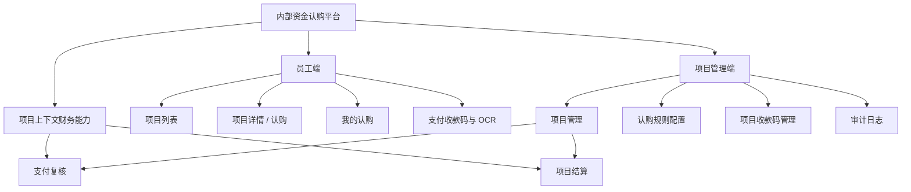
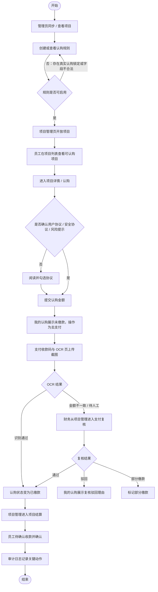

# 内部资金认购平台 PRD（基于当前前端页面反向生成）

## 1. 文档信息

| 字段 | 内容 |
|---|---|
| 文档类型 | PRD（Product Requirements Document，产品需求文档） |
| 产品名称 | 内部资金认购平台 |
| 文档版本 | v1.1-current-frontend |
| 生成日期 | 2026-07-09 |
| 生成依据 | 当前前端页面 `src/App.vue`、样式 `src/styles.css`、本地 API（Application Programming Interface，应用程序接口）`server/server.ts` |
| 项目路径 | `/Users/phoenix/Documents/众筹6-自己的自动开发skill` |
| 当前运行形态 | Vue 3（前端框架）+ Element Plus（组件库）+ Node.js API（服务端接口）+ JSON（结构化数据文件）本地持久化 |
| 关联文档 | `docs/01-产品PRD.md`、`docs/02-需求规格说明书.md`、`docs/02-功能清单.md` |

## 2. 背景与问题

公司内部采购、销售或集采项目存在员工认购、线下缴款、截图 OCR（Optical Character Recognition，光学字符识别）、财务复核、项目结算和公司兜底等多角色协作场景。若继续依赖表格和群消息，会产生以下问题：

- 项目是否可认购、剩余可认购金额、认购截止时间和认购进度无法实时统一。
- 员工认购后，未缴款、待复核、复核驳回、已缴款、待确认收款等状态容易分散在不同沟通渠道。
- 管理端难以约束认购规则、收款码、项目开放、中断、强制接管和结算入口。
- 财务端难以从项目维度进入支付复核和结算，截图、OCR 金额、到账时间、复核人、复核时间、驳回理由缺少统一记录。
- 资金类关键动作若没有审计日志，会影响责任追踪和后续对账。

本 PRD 以当前前端页面为事实来源，描述已经展示或已通过项目上下文可达的产品能力，不把已删除或已隐藏页面继续列为前台需求。

## 3. 产品目标

### 3.1 北极星目标

建立一个覆盖“项目开放前配置 → 员工认购 → 缴款 OCR → 财务复核 → 项目结算 → 审计追踪”的内部资金认购工作台，使员工、管理员和财务能在同一套页面中完成关键状态流转。

### 3.2 成功指标

| 指标 | 目标 | 说明 |
|---|---:|---|
| 核心链路页面覆盖率 | 100% | 当前前端需覆盖项目列表、项目详情、我的认购、项目管理、认购规则配置、项目收款码管理、支付复核、项目结算、审计日志 |
| 认购状态可追踪率 | 100% | 每条认购记录展示状态、金额、项目、收益和下一步操作 |
| 支付复核闭环率 | 100% | 待复核记录可被通过、驳回或标记部分缴款；驳回必须记录原因 |
| 规则配置合规率 | 100% | 开放认购金额和单次认购最低金额按公式自动派生，不允许手工篡改 |
| 本地可运行验证 | 100% | `npm run build`（构建命令）通过，前端和 API 可本地启动 |

## 4. 范围定义

### 4.1 本期范围

| 模块 | 页面 / 能力 | 当前状态 |
|---|---|---|
| 员工端 | 项目列表、项目详情 / 认购、我的认购、支付收款码与 OCR | 前端已实现 |
| 项目管理端 | 项目管理、认购规则配置、项目收款码管理、审计日志 | 前端已实现 |
| 财务端 | 支付复核、项目结算 | 左侧菜单隐藏，通过项目管理行内按钮跳转 |
| 管理增强 | 强制接管、支付复核入口、去结算入口 | 集中在项目管理页 |
| 数据与审计 | 本地 API、JSON 持久化、审计日志、状态归一化 | 本地已实现 |

### 4.2 当前明确删除 / 隐藏范围

| 页面 / 控件 | 当前处理 | 产品原因 |
|---|---|---|
| 通知与风险事件页 | 已删除前端页面和菜单入口 | 当前不再作为独立菜单页；风险类信息沉淀到具体业务动作和审计中 |
| 权限管理页 | 左侧菜单隐藏 | 当前不作为独立操作入口；生产权限需由后端 RBAC（Role-Based Access Control，基于角色的访问控制）承接 |
| 支付复核页 | 左侧菜单隐藏 | 通过项目管理页的“支付复核”进入，避免财务孤立处理无项目上下文的数据 |
| 项目结算页 | 左侧菜单隐藏 | 通过项目管理页的“去结算”进入，保留归属项目信息 |
| 公司兜底管理页 | 左侧菜单隐藏 | 强制接管入口已迁移到项目管理页 |
| 顶部角色切换 segmented 控件 | 已删除 | 当前页面不再提供前台角色切换控件；仅保留账号和当前视角展示 |

### 4.3 非目标

- 不在本期实现真实登录、SSO（Single Sign-On，单点登录）或 OAuth（开放授权）。
- 不在本期接入真实 MCP（Model Context Protocol，模型上下文协议）、真实支付网关、真实 OCR、真实发票验真。
- 不在本期证明生产级并发防超卖；当前防超卖仅为本地 API 逻辑。
- 不恢复独立的“通知与风险事件”“权限管理”“公司兜底管理”菜单页。
- 不把本地 JSON 文件持久化视为生产数据库方案。

## 5. 角色与用户场景

| 角色 | 当前账号展示 | 核心诉求 | 主要触达页面 |
|---|---|---|---|
| 员工 | `employee01` | 查看可认购项目、提交认购、去支付、查看复核结果、确认收款 | 项目列表、项目详情 / 认购、我的认购、支付收款码与 OCR |
| 管理员 | `admin01` | 同步项目、配置规则、开放 / 中断项目、维护收款码、查看审计 | 项目管理、认购规则配置、项目收款码管理、审计日志 |
| 财务 | `finance01` | 从项目上下文处理支付复核和项目结算 | 项目管理 → 支付复核、项目管理 → 项目结算 |
| 公司超级管理员 | `superadmin01` | 查看项目全局状态、执行强制接管、关注结算和审计 | 项目管理、审计日志 |
| 系统任务 | `system` | 同步、状态归一化、审计记录 | 后台 API |

> 说明：当前前端是本地 MVP（Minimum Viable Product，最小可用产品），账号和角色用于页面展示与模拟流程；生产版本必须由后端鉴权控制页面和接口权限。

## 6. 当前信息架构

## 7. 核心业务流程

## 8. 页面需求

### 8.1 项目列表

| 项目 | 需求 |
|---|---|
| 页面目标 | 员工快速查看项目状态、认购进度、剩余可认购金额和截止认购时间 |
| 核心字段 | 序号、项目名称、项目编码、项目状态、我的认购状态、我的认购笔数、认购进度、剩余可认购金额、截止认购时间 |
| 核心操作 | 状态筛选、认购状态筛选、认购笔数筛选、项目关键字搜索、查看详情、去认购 |
| 排序要求 | 认购进度、剩余可认购金额、截止认购时间支持排序 |
| 业务规则 | 我的认购笔数大于 0 时可跳转到“我的认购”查看目标项目认购情况；已截止、已满额、已中断项目不可继续认购 |
| 验收标准 | 用户能通过筛选和排序定位可认购项目；项目编码和名称同时可见 |

### 8.2 项目详情 / 认购

| 项目 | 需求 |
|---|---|
| 页面目标 | 员工查看项目基础信息并发起认购 |
| 核心字段 | 项目名称、项目编码、项目来源、总开放认购金额、认购时间、收益规则、认购进度、剩余可认购金额、公司总认购金额 |
| 核心操作 | 查看协议、勾选协议、输入认购金额、立即认购 |
| 协议要求 | 用户协议、安全协议、风险提示文案需带下划线，表示可点击查看 |
| 金额规则 | 认购金额不得低于当前项目规则的单次认购最低金额，不得超过剩余可认购金额 |
| 验收标准 | 未确认协议时不能完成认购；确认协议且金额合法时生成认购记录 |

### 8.3 我的认购

| 项目 | 需求 |
|---|---|
| 页面目标 | 员工查看本人认购记录和下一步操作 |
| 核心字段 | 序号、认购编号、项目名称、申请认购金额、状态、截止缴款剩余时长、缴款图上传时间、预估收益、操作 |
| 筛选要求 | 支持认购编号 / 项目关键字、项目、状态、最低金额、最高金额筛选 |
| 状态要求 | 支持未缴款、待复核、复核驳回、待确认收款、已缴款、已收款、已释放 |
| 驳回展示 | 复核驳回状态必须展示驳回理由；默认最多三行，鼠标悬停显示完整内容 |
| 操作文案 | 未缴款状态操作按钮文案为“去支付” |
| 释放规则 | 已释放代表过期未缴款认购单，其金额释放回项目剩余可认购金额 |
| 验收标准 | 复核驳回记录能看见原因；未缴款记录操作为“去支付”；金额列内容左对齐 |

### 8.4 支付收款码与 OCR

| 项目 | 需求 |
|---|---|
| 页面目标 | 员工根据认购记录完成线下支付和截图上传 |
| 进入方式 | 仅通过“我的认购”页的“去支付”按钮进入，不作为独立左侧菜单页 |
| 核心字段 | 项目收款码、应付金额、上传支付截图、OCR 金额、识别状态、置信度 |
| 核心操作 | 上传截图、模拟识别通过、模拟金额不匹配、模拟识别失败 |
| 业务规则 | OCR 通过更新为已缴款；金额不一致进入待复核；失败提示重新上传 |
| 验收标准 | 支付状态在“我的认购”和财务复核队列中一致 |

### 8.5 项目管理

| 项目 | 需求 |
|---|---|
| 页面目标 | 管理员统一管理项目状态、认购进度、规则、复核、结算和强制接管 |
| 核心字段 | 序号、项目、项目状态、参与认购人数、总认购笔数、认购进度、剩余可认购金额、员工未缴款认购金额、认购截止时间、开放认购金额、开放认购比例、项目成本金额、项目销售金额、项目利润、公司固定认购金额、剩余可强制接管金额、归属认购利润、结算状态、规则配置、操作 |
| 字段顺序要求 | 公司固定认购金额、剩余可强制接管金额位于项目利润右侧 |
| 搜索要求 | 支持项目关键字、项目状态、结算状态筛选 |
| 操作要求 | 支付复核、去结算、开放、终止、强制接管、规则配置查看 |
| 数据口径 | 参与认购人数需按用户去重；过期未缴款并已释放的认购单不计入总认购笔数 |
| 验收标准 | 管理员可从具体项目行进入支付复核和项目结算；列内容左对齐；隐藏的财务页面仍可通过项目上下文到达 |

### 8.6 认购规则配置

| 项目 | 需求 |
|---|---|
| 页面目标 | 管理员维护项目开放认购所需的规则配置 |
| 核心字段 | 序号、规则名称、规则编号、所属项目、实际可认购金额、单次认购最低金额、开放参与人数、允许多次、公司兜底、状态、截止时间、更新时间、操作 |
| 筛选要求 | 支持所属项目、规则状态、关键词搜索 |
| 创建 / 编辑规则 | 所属项目、项目收款码、规则名称、开放认购时间、公司固定认购金额、开放参与人数、是否允许多次认购、截止后公司兜底、发布状态 |
| 派生规则 | 开放认购金额不支持手动输入，开放认购金额 = 项目成本金额 - 公司固定认购金额 |
| 派生规则 | 单次认购最低金额不支持手动输入，单次认购最低金额 = 开放认购金额 / 开放参与人数 |
| 校验规则 | 公司固定认购金额必须小于项目成本金额；开放参与人数不能低于 1 |
| 状态操作 | 未启用规则支持修改、启用、删除；已启用规则支持停用；已停用规则可删除 |
| 锁定规则 | 目标规则对应项目一旦有真实用户认购记录，规则内容只读，不支持修改或删除 |
| 验收标准 | 创建弹窗展示派生金额；未启用状态展示“修改 / 启用 / 删除”；启用后状态切换为已启用 |

### 8.7 项目收款码管理

| 项目 | 需求 |
|---|---|
| 页面目标 | 管理员 / 财务维护认购规则可选择的收款码 |
| 核心字段 | 收款码编号、收款主体、账户说明、收款码名称、状态、更新人、更新时间、禁用原因 |
| 核心操作 | 创建收款码、禁用收款码、按状态 / 关键字筛选 |
| 业务规则 | 只有启用状态的收款码可被认购规则选择 |
| 验收标准 | 规则创建弹窗中可查看项目收款码预览；禁用收款码需填写禁用理由 |

### 8.8 支付复核

| 项目 | 需求 |
|---|---|
| 页面目标 | 财务核验员工支付截图、OCR 结果与认购记录 |
| 进入方式 | 项目管理页行内“支付复核”进入；页面提供返回项目管理按钮 |
| 核心字段 | 待复核队列、项目名称、项目编码、复核员工、上传截图时间、识别到的支付成功时间、实际上传截图、应付金额、OCR 金额、置信度、复核人、复核时间 |
| 核心操作 | 通过、驳回、标记部分缴款 |
| 业务规则 | 复核通过后记录不再显示在待复核队列；驳回必须填写驳回理由；需记录复核人员与操作时间 |
| 验收标准 | 复核后“我的认购”同步展示状态；驳回理由在员工侧可见 |

### 8.9 项目结算

| 项目 | 需求 |
|---|---|
| 页面目标 | 财务录入 / 查看项目收入成本，试算员工收益与公司收益 |
| 进入方式 | 项目管理页行内“去结算”进入；页面提供返回项目管理按钮 |
| 核心字段 | 归属项目、项目编码、项目状态、结算状态、认购截止时间、项目销售收入、采购与执行成本、其他费用、可分配利润、员工 / 项目、有效认购、收益 |
| 核心操作 | 结算试算、发票上传 / OCR 模拟、返回项目管理 |
| 验收标准 | 结算页展示归属项目信息；从项目管理进入后上下文不丢失 |

### 8.10 审计日志

| 项目 | 需求 |
|---|---|
| 页面目标 | 管理员查看资金相关操作追踪 |
| 核心字段 | 时间、操作人、动作、目标、结果、操作 |
| 筛选要求 | 操作人关键字、结果下拉选择，结果支持全部、成功、失败 |
| 核心操作 | 查看差异 |
| 验收标准 | 关键动作能被审计日志追踪；结果筛选为下拉选择器 |

## 9. 状态与规则

### 9.1 项目状态

| 状态 | 中文说明 | 页面规则 |
|---|---|---|
| 未开放 | 项目尚未对员工开放认购 | 可在项目管理页配置规则并开放 |
| 未满额 | 项目已开放且仍有剩余额度 | 员工可认购，管理员可强制接管 |
| 已满额 | 项目认购进度达到 100% 或剩余额度为 0 | 员工不可继续认购，可进入结算 |
| 已截止 | 到达认购截止时间 | 员工不可继续认购 |
| 已中断 | 管理端主动中断 | 需展示中断原因和 48 小时返款提示 |
| 已完结 | 项目完成结算或归档 | 仅查看与审计 |

### 9.2 认购 / 支付状态

| 状态 | 中文说明 | 下一步 |
|---|---|---|
| 未缴款 | 员工已申请认购但未完成有效缴款 | 去支付 |
| 待复核 | OCR 异常或需财务人工核验 | 财务复核 |
| 复核驳回 | 财务认定截图或金额不合规 | 展示驳回理由，员工重新上传 |
| 部分缴款 | 实际到账金额不足 | 财务后续处理 |
| 已缴款 | 支付已确认 | 等待结算 |
| 待确认收款 | 结算后员工需确认收益收款 | 员工确认收款 |
| 已收款 | 员工已确认收款 | 归档 |
| 已释放 | 过期未缴款认购单释放额度 | 金额回到剩余可认购金额 |

### 9.3 结算状态

| 状态 | 中文说明 |
|---|---|
| 未到结算 | 项目尚未进入结算阶段 |
| 待结算 | 项目满足结算入口条件 |
| 退款处理中 | 项目中断或异常后进入退款处理 |
| 已结算 | 项目完成结算 |

## 10. 数据需求

| 数据对象 | 关键字段 | 中文说明 |
|---|---|---|
| `Project` | `id`、`title`、`status`、`deadline`、`total`、`costAmount`、`salesAmount`、`profitAmount`、`companyFixedAmount`、`companyForcedTakeoverAmount` | 项目基础与金额信息 |
| `Subscription` | `id`、`projectId`、`userId`、`amount`、`pay`、`profit`、`paymentDeadlineAt`、`paymentUploadedAt`、`paymentSuccessAt`、`reviewedBy`、`reviewedAt`、`rejectReason` | 员工认购与支付状态 |
| `SubscriptionRule` | `id`、`projectId`、`ruleName`、`totalAmount`、`companyFixedAmount`、`minAmount`、`minParticipants`、`receivingCodeId`、`status` | 认购规则 |
| `ReceivingCode` | `id`、`subject`、`accountNote`、`codeName`、`status`、`updatedBy`、`disabledReason` | 项目收款码 |
| `AuditLog` | `time`、`actor`、`role`、`action`、`target`、`before`、`after`、`result` | 审计日志 |

## 11. API 映射

| Method（请求方法） | Endpoint（接口地址） | 中文说明 |
|---|---|---|
| `GET` | `/api/health` | 健康检查 |
| `GET` | `/api/state` | 获取完整本地状态 |
| `GET` | `/api/projects` | 获取项目列表 |
| `GET` | `/api/rules` | 获取认购规则列表 |
| `GET` | `/api/subscriptions` | 获取认购记录 |
| `GET` | `/api/audit-logs` | 获取审计日志 |
| `POST` | `/api/mcp/sync` | 模拟采购系统同步 |
| `POST` | `/api/subscriptions` | 创建认购 |
| `POST` | `/api/subscriptions/:id/confirm-receipt` | 员工确认收款 |
| `POST` | `/api/subscriptions/:id/review` | 财务复核 |
| `POST` | `/api/rules` | 创建认购规则 |
| `POST` | `/api/rules/:id/update` | 修改认购规则 |
| `POST` | `/api/rules/:id/status` | 启用 / 停用认购规则 |
| `POST` | `/api/rules/:id/delete` | 删除认购规则 |
| `POST` | `/api/projects/:id/open` | 开放项目认购 |
| `POST` | `/api/projects/:id/terminate` | 终止项目认购 |
| `POST` | `/api/projects/:id/interrupt` | 中断项目认购 |
| `POST` | `/api/payments/ocr` | 支付截图 OCR 模拟 |
| `POST` | `/api/settlements/calc` | 结算试算 |
| `POST` | `/api/takeovers/:id/force` | 公司强制接管 |

## 12. 验收标准

| 编号 | 验收项 | 通过标准 |
|---|---|---|
| AC-001 | 菜单边界 | 左侧不展示通知与风险事件、权限管理、支付复核、项目结算、公司兜底管理独立入口 |
| AC-002 | 顶部操作 | 顶部不展示角色切换 segmented 控件，仅保留账号视角提示和登出 |
| AC-003 | 项目列表 | 支持项目筛选、排序、分页；字段文案为截止认购时间 |
| AC-004 | 我的认购 | 未缴款按钮为“去支付”；复核驳回展示三行内原因并支持悬停查看完整内容 |
| AC-005 | 支付页进入 | 支付收款码与 OCR 页只能从“去支付”进入 |
| AC-006 | 项目管理 | 公司固定认购金额、剩余可强制接管金额位于项目利润右侧 |
| AC-007 | 认购规则 | 开放认购金额和单次认购最低金额按公式派生，不能手工输入 |
| AC-008 | 规则状态 | 未启用规则支持修改、启用、删除；启用后状态变为已启用 |
| AC-009 | 财务复核 | 复核通过后不再显示于待复核队列；驳回必须记录理由、复核人和操作时间 |
| AC-010 | 项目结算 | 结算页展示归属项目信息，并支持返回项目管理 |
| AC-011 | 审计日志 | 结果筛选为下拉选择器，支持全部、成功、失败 |
| AC-012 | 本地构建 | `npm run build` 通过 |

## 13. 风险与待确认

| 风险 / 待确认项 | 影响 | 建议 |
|---|---|---|
| 当前无真实登录和接口级 RBAC | 前端隐藏不等于安全控制 | 生产版本必须后端鉴权 |
| JSON 本地持久化不支持并发事务 | 无法证明高并发无超卖 | 引入数据库事务和并发压测 |
| OCR、MCP、发票、支付仍为模拟 | 无法作为真实财务凭证 | 接入真实服务后补集成测试 |
| 部分缴款后续策略未完全固化 | 影响财务处理闭环 | 财务确认补缴、退款、释放额度规则 |
| 顶部角色切换已删除 | 测试多角色需要其他入口或账号体系 | 生产登录完成前，可保留测试账号说明或开发工具入口 |

## 14. 变更记录

| 日期 | 版本 | 变更 |
|---|---|---|
| 2026-07-09 | v1.1-current-frontend | 基于当前前端页面反向生成 PRD；同步删除通知与风险事件页、隐藏页面入口、移除顶部角色切换等最新页面边界 |

